> Feedback welcome: Feel free to leave a message or any hints in the ["General Feedback"](https://github.com/eh2k/squares-and-circles/issues/1) issue.

# □︎●︎ [](https://eh2k.github.io/□●/flash/?firmware) [](https://www.modulargrid.net/e/modules/browser?SearchName=squares+and+circles&SearchShowothers=1)

<!-- ⧉⦾ ⧇ ⟥⧂ -->
**squares-and-circles** is an alternate firmware for the Eurorack module Ornament & Crime (O_C), specifically targeting the Teensy 4.0.

>  <a href="CHANGELOG.txt">CHANGELOG.txt</a> · New here? Start with the <a href="quick-start.md">Quick start</a>

## ■ Demos

| [](https://www.youtube.com/watch?v=WQj3YqGpxRU) | [](https://youtu.be/QdlwETEaE3A) | [](https://youtu.be/lb-pbm1ddRw) | [](https://youtu.be/J1vmVwwdVU4)
|--|--|--|--|

## Acknowledgments & Credits

Thanks to the creators of ornament & crime (o_C) and PJRC for the Teensy, and all those who have worked on the [code and algorithms](https://github.com/eh2k/squares-and-circles/wiki/credits) that are reused here, especially Mutable Instruments.
They served a great source of learning and provided a huge playground and the foundation for this project.

## Motivation / Challenge

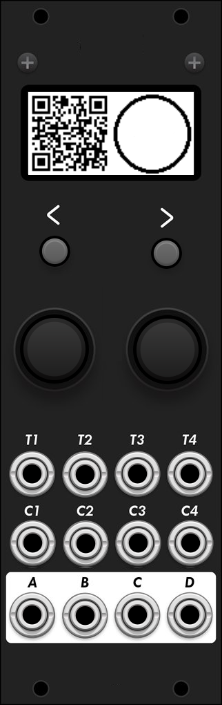


Given are the following ingredients: Two buttons, two encoders and a 128x64 display. Sixteen I/O ports (4x trigs, 4x cv and 4x dac) and a Cortex-M7.

Damn many possibilities to complicate it. Mono, stereo and then again CV. A tricky task to design a simple UI logic, not get lost in menu diving, and to get as much out of the hardware as possible (work in progress).

## Concept

Similar to the Monomachine and Machinedrum, this device features four fully configurable engine instances. Each instance can be assigned a synthesizer, effects, or sequencer engine, which can be controlled via trigger inputs, CV inputs, or clock signals.

The available engine types include drums, synthesizers, oscillators, sequencers, and audio processors. The hardware ports and the generated output signals can be internally routed to any engine. For example, you can route the mono audio signal from an oscillator engine to a neighboring effects engine with stereo outputs, enabling seamless signal chaining.

* [Short Press [LEFT]/[RIGHT]] scrolls through the 4 machine-tracks; an engine with a second page of parameters (SYNTH/XX-303) comes with its pages on the way (track 1 page 1, track 1 page 2, track 2, ...; the channel bar shows the page in the track's segment). A drum kit (DRUMKITS/*) has its mix page after its parameters, while two instruments or more play (their own TRIGs, MIDI): LEVEL and PAN of each instrument.
* [Long press [LEFT]] enters the machine-selection-page.
* [Long press [RIGHT]] enters the [I/O-Configuration page](#io-configuration).
* [Long press [LEFT] + [RIGHT]] opens the menu: turn an encoder to choose machines/engines, I/O, CLK & MIDI settings or patch storage, press it to open (on any other page: back to the engine page).
* [Long press left or right [ENCODER]] shows the modulation popup
* [Long press [L-ENCODER] + [R-ENCODER]] enters the [patch storage page](#patch-storage) - the patch saved or loaded last is restored at startup
  - DEBUG: skip restore - press [RIGHT] button while startup ).

<br/>
<div style="page-break-after: always;"></div>

# Machines <sup>[wiki](https://github.com/eh2k/squares-and-circles/wiki/%E2%96%A1%EF%B8%8E%E2%97%8F%EF%B8%8E-Machines-&-Engines)</sup>

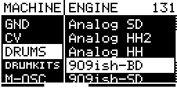

* [Long press [LEFT]] enters the machine-selection-page.<br/>
* [Turn [L-ENCODER]] selects the machine (category), [Turn [R-ENCODER]] the engine - the engine of the track is highlighted.<br/>
* [Short press [R-ENCODER]] loads the selected engine.<br/>
* [Long press [R-ENCODER]] loads the selected engine - extended mode: turn [R-ENCODER] to choose, press it to confirm.<br clear="right"/>
   * Load & reset I/O settings 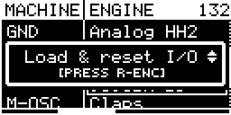
   * Load & keep IO settings<br clear="right"/>
   * Copy #1-4 (parameter values + modulations + I/O settings of track 1-4) 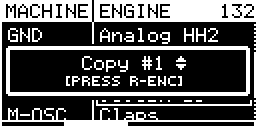

<br clear="right"/>

---
###### Screenshots
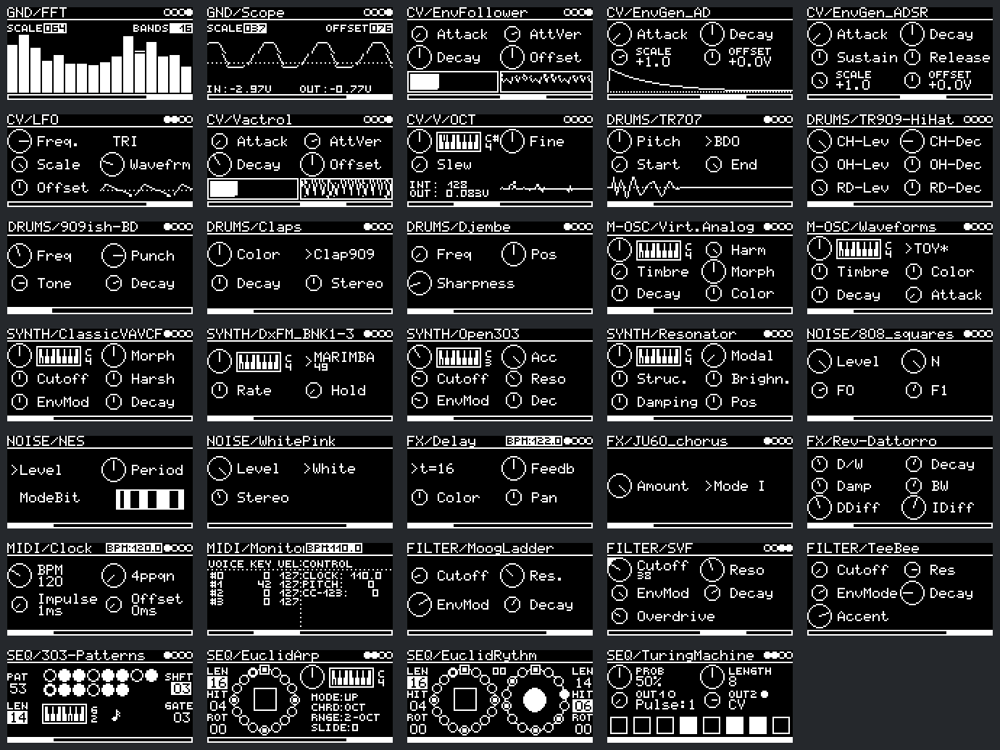

---

## Engines

| Group | Engines |
|---|---|
| **GND** | `---`, [Scope](app/GND/Scope/README.md), [FFT](app/GND/FFT/README.md), [Tuner](app/GND/Tuner/README.md), [Midi-Monitor](app/GND/Midi-Monitor/README.md) |
| **CV** | [V_OCT](app/CV/V_OCT/README.md), [EnvGen_AD](app/CV/EnvGen/README.md), [EnvGen_ADSR](app/CV/EnvGen/README.md), [LFO](app/CV/LFO/README.md), [EnvFollower](app/CV/EnvFollower/README.md), [Vactrol](app/CV/EnvFollower/README.md) |
| **Drums** | [Analog-BD](app/SYNTH/plaits/README.md), [Analog-SD](app/SYNTH/plaits/README.md), [Analog-HH](app/SYNTH/plaits/README.md), [Analog-HH2](app/SYNTH/plaits/README.md), [909ish-BD](app/SYNTH/plaits/README.md), [909ish-SD](app/SYNTH/plaits/README.md), [TR909-HiHat](app/DRUMS/TR909-HiHat/README.md), [808ish-BD](app/DRUMS/808ish-BD/README.md), [808ish-SD](app/DRUMS/808ish-SD/README.md), [808ish-HiHat](app/DRUMS/808ish-HiHat/README.md), [FM-Drum](app/DRUMS/FM-Drum/README.md), [Djembe](app/DRUMS/Djembe/README.md), [Claps](app/DRUMS/Claps/README.md) |
| **DRUMKITS** | [TR-707](app/DRUMKITS/TR-707/README.md), [RZ-1](app/DRUMKITS/RZ-1/README.md), [DMX](app/DRUMKITS/DMX/README.md), [Linn](app/DRUMKITS/Linn/README.md), [DrumSynth](app/DRUMKITS/DrumSynth/README.md): [CR-78](app/DRUMKITS/CR-78/README.md), [CR-8000](app/DRUMKITS/CR-8000/README.md), [DR-110](app/DRUMKITS/DR-110/README.md), [KR-55](app/DRUMKITS/KR-55/README.md), [MFB-512](app/DRUMKITS/MFB-512/README.md), [TR-606](app/DRUMKITS/TR-606/README.md), [TR-808](app/DRUMKITS/TR-808/README.md), [TR-909](app/DRUMKITS/TR-909/README.md) |
| **SYNTH** | [Braids](app/SYNTH/braids/README.md), [Plaits](app/SYNTH/plaits/README.md): Plaits' 16 models (synth and speech), [SAM](app/SYNTH/SAM/README.md), [Rings](app/SYNTH/rings/README.md), [DxFM](app/SYNTH/DxFM/README.md), [DxFM_BNK1-3](app/SYNTH/DxFM/README.md), [XX-303](app/SYNTH/XX-303/README.md) |
| **FX** | [Reverb](app/FX/Reverb/README.md), [ReverbSC](app/FX/ReverbSC/README.md), [Rev-Dattorro](app/FX/Rev-Dattorro/README.md), [Delay](app/FX/Delay/README.md), [Gated-Reverb](app/FX/Gated-Reverb/README.md), [Reverb-HP-LP](app/FX/Reverb-HP-LP/README.md), [JU60_chorus](app/FX/JU60_chorus/README.md), [Drive](app/FX/Drive/README.md), [Ducker](app/FX/Ducker/README.md), [Compressor](app/FX/Compressor/README.md), [FV1emu](app/FX/FV1emu/README.md): FV-1 programs from a flash blob |
| **NOISE** | [NoiseGen](app/NOISE/NoiseGen/README.md), [NES_noise](app/NOISE/NES/README.md), [808_squares](app/NOISE/808_squares/README.md) |
| **FILTER** | [SVF](app/FILTER/SVF/README.md), [MoogLadder](app/FILTER/MoogLadder/README.md) |
| **SEQ** | [EuclidRythm](app/SEQ/EuclidRythm/README.md), [EuclidArp](app/SEQ/EuclidArp/README.md), [TuringMachine](app/SEQ/TuringMachine/README.md), [303-Patterns](app/SEQ/303-Patterns/README.md), [Clock](app/SEQ/Clock/README.md) |

## Machine/Engine

Machines/Engines are controlled by individual parameters.

>[Short press left/right [ENCODER]] changes parameter selection<br/>
>[Rotate left/right [ENCODER]] changes parameter value

### Modulations

>[Long press left or right [ENCODER]] shows/hides the modulation popup*


For each parameter a modulation can be assigned:
  * **CV**: 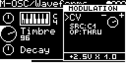
    * SRC:
      * `C1`, `C2`, `C3`, `C4` - Analog inputs, `$1A`..`$4D` - virtual signals (outputs of the engines, see [I/O-Configuration](#io-configuration))
        * OP: `THRU`, `SLEW`, `S&H`, `T&H`
          * THRU - Thru Input
          * SLEW - Slew Limiter
            - Rising
            - Falling
          * S&H - Sample and Hold 
            - TRIG: Trig Source
          * T&H - Track and Hold 
            - GATE: Gate Source
      * `+` - Constant internal voltage
        * -9.99V..+9.99V in 10mV steps, set with the knob - nice for fine adjustments (detuning etc)
    * The attenuverter of CV goes from -2 to +2; the bottom line shows the input voltage and the factor (e.g. `+2.5V X 1.0`)
    * Hints:
      * Parameter 0 (top-left) is primarily used for V/OCT control. Therefore, a single V/OCT signal or CV input can be shared by applying modulation to parameter 0 with an attenuverter set to +1, within the -3V to +6V range. It is also possible to select the V/OCT input in the io-configuration page.
      * All other parameters can be modulated via CV-input with a assumed voltage-range of -4V..4V at 2kHz sample rate.
      * Be aware the CV-range is probably limited by hardware to: -3.5v..6.5V<br clear="right"/>
  * **RND**: Trigger generates a random voltage 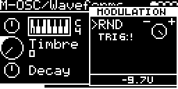
    * TRIG: `!`, `T1`, `T2`, `T3`, `T4`, `C1`, `C2`, `C3`, `C4`, `$1A`..`$4D`<br clear="right"/>
  * **ENV**: Triggered Envelope (Attack, Decay) 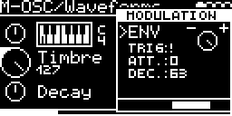

    * TRIG: `!`, `T1`, `T2`, `T3`, `T4`, `C1`, `C2`, `C3`, `C4`, `$1A`..`$4D`
    * ATT.: Attack
    * DEC.: Decay<br clear="right"/>
 * **LFO**: Free/Triggered Sine-LFO 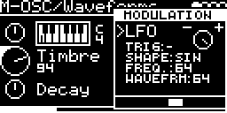
    * TRIG: `-` (free running), `!`, `T1`, `T2`, `T3`, `T4`, `C1`, `C2`, `C3`, `C4`, `$1A`..`$4D`
    * SHAPE: `SIN`, `TRI`, `SQR`, `STEPS`, `NOISE`
    * FREQ.: `0-127`
    * WAVEFRM: `0-127`<br clear="right"/>
  * **EF**: Envelope Follower 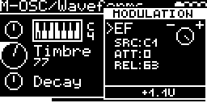
    * SRC: `C1`, `C2`, `C3`, `C4`, `$1A`..`$4D`
    * ATT: Attack
    * REL: Release<br clear="right"/>
  * **TM**: Turing Machine  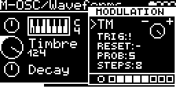
    * TRIG: `!`, `CLK`, `T1`, `T2`, `T3`, `T4`, `C1`, `C2`, `C3`, `C4`, `$1A`..`$4D`
    * RESET: `-`, `T1`, `T2`, `T3`, `T4`, `C1`, `C2`, `C3`, `C4`, `$1A`..`$4D`
    * PROB: `0-9` (0-100%)
    * STEPS: `1-16`<br clear="right"/>
  * **SEQ**: 4-Step Sequencer 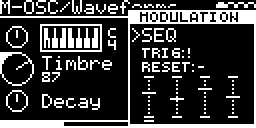
    * TRIG: `!`, `T1`, `T2`, `T3`, `T4`, `C1`, `C2`, `C3`, `C4`, `$1A`..`$4D`, `CLK/1`, `CLK/4`, `CLK/16`, `CLK/32`, `CLK/96`
    * RESET: `-`, `T1`, `T2`, `T3`, `T4`, `C1`, `C2`, `C3`, `C4`, `$1A`..`$4D`
    * 4-STEPS: `-64..64` (shown as sliders; integer parameters: at most half their range)<br clear="right"/>
 >`!` = current engine trigger<br/>
 >`CLK` = internal clock<br/>
 All modulations have an attenuverter parameter (the knob at the top right of the popup, -/+).
  * The modulation-voltage is attenuverted/multiplied by -1..+1 (CV: -2..+2);
 >Press the encoder of the popup's side to step through its rows (the modulation type first), turn it to change the value.

<div style="page-break-after: always;"></div>

## I/O-Configuration

>[Long press [RIGHT]] enters the I/O-Configuration page.

The I/O-Configuration page lets you virtually patch the engine with the hardware ports and internal gate/cv signals ($1A-$4D). The page title is the engine of the track; the page is a list in two sections, `CTRL/INPUTS` and `MIX/OUTPUTS` - which rows appear depends on the engine interface. In addition to the trigger, which is set with a rising edge, a gate state is also provided, that can be processed by the engine. Engines like Closed/Open-HiHats have an additional accent input - this works technically like a second trigger. The V/OCT input can optionally be quantized and transposed. In addition to the Tx inputs, the Cx inputs can also be used as a source for triggers and accents. The output can be configured as mono or stereo. Several engines can share the same output - the signal is mixed.

The small symbol in front of an input's value shows what arrives there: a dot that lights up on each trigger (trigger/accent inputs), a small box with the voltage (V/OCT input).

*Virtual signals* `$1A`..`$4D`: the outputs of the engines can be used as trigger or CV source of another track - `$<track><output>`, e.g. `$3A` is the first output of track 3. While turning to a virtual signal, a box shows the track's engine and the output behind it; turning skips the places without an output (shown as `-`, e.g. `-2C`). The trigger, V/OCT and CV lists offer only the CV outputs; the audio outputs are offered only as source of the envelope follower (modulation EF).

### Ctrl / Inputs

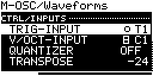

*In case the Engine supports Triggers/Gates - Trigger Input is configurable:*

 * **TRIG-INPUT**:
   * `-`
   * `T1`, `T2`, `T3`, `T4`, `C1`, `C2`, `C3`, `C4`
   * `$1A`..`$4D`
   * `$1MIDI`..`$4MIDI`: the MIDI out of that track (e.g. [MIDI/GM-Drums](app/MIDI/GM-Drums/README.md), whatever
     its MIDI-OUT and channel), in addition to the MIDI channel of the settings page
     - the notes trigger the engine like a trigger input: trigger, gate, accent (velocity > 100), and a modulation
       with TRIG `!` fires on each note
     - engines with V/OCT take the pitch from the notes as well: V/OCT-INPUT shows the same `$nMIDI` and the CV
       input is left out (it comes back when TRIG-INPUT is turned to an input again); drum kits keep their V/OCT
       input, their notes pick the instruments
     - several tracks with the same source share its notes as voices, as the tracks of one MIDI channel do
     - MIDI engines get every message as on their channel; drum kits play their instruments by the keys of the
       notes (GM keys), with their velocity, and keep the trigger inputs of their instruments as with `-`
     - turning passes over the own track and tracks without MIDI output. Changing it, or the source track's engine,
       ends the notes held

*While another track's engine sends MIDI - for MIDI engines without TRIG-INPUT and V/OCT-INPUT (e.g.
[GND/Midi-Monitor](app/GND/Midi-Monitor/README.md)):*

 * **MIDI-INPUT**:
   * `-`
   * `$1MIDI`..`$4MIDI`: as TRIG-INPUT `$nMIDI` above


 * **CLOCK-SOURCE**:
   * `CLK` - global clock -> [CLOCK+TIMING+MIDI-Settings](#clocktimingmidi-settings).
   * `T1`, `T2`, `T3`, `T4`, `C1`, `C2`, `C3`, `C4`
   * `$1A`..`$4D`

*In case the Engine supports Accents (Closed/Open HiHat) - Accent Input is configurable (engines without trigger input: **RESET-TRIG**):*

 * **ACCENT-INPUT**:
   * `-`
   * `T1`, `T2`, `T3`, `T4`, `C1`, `C2`, `C3`, `C4`
   * `$1A`..`$4D`

 *In case the Engine supports V/OCT - V/OCT Input is configurable:*

 * **V/OCT-INPUT**: `-`, `C1`, `C2`, `C3`, `C4`, `$1A`..`$4D`
   * V/OCT: -3V..6V for frequency-control (default)
   * `$1MIDI`..`$4MIDI` for engines without TRIG-INPUT (e.g. [CV/V_OCT](app/CV/V_OCT/README.md), the SEQ engines):
     the pitch from the notes of that track, as TRIG-INPUT `$nMIDI` above (the CV input is left out). With
     TRIG-INPUT `$nMIDI` the row shows the same and does not turn
 * **QUANTIZER**: [OFF, Semitones, Ionian, Dorian, ...](lib/braids/quantizer_scales.h)
   * **ROOT**: `C`, `C#`, `D`, `D#`, `E`, `F`, `F#`, `G`, `G#`, `A`, `A#`, `B`
 * **TRANSPOSE**: semitone per step
   * **FINE**: semitone/128

*Engines with additional CV inputs (e.g. CV/EnvFollower) show a `<name>-INPUT` row for each; trigger and CV inputs of the parameter modulations follow in a `MODULATIONS` section.*

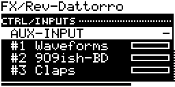

*In case the Engine is an AUDIO_PROCESSOR - Input signal mix is configurable:*
 * **AUX-INPUT**: `-`, `C1`, `C2`, `C3`, `C4`, `USB`
   * AUX-IN: -3V..3V for additional audio source for effects (prefer CV4).
   * `USB`: what the computer plays on the module's USB sound card (see [USB-Audio](#--usb-audio))
   * **AUX-LEVEL**: Feed-in level of the aux-input; only with an AUX-INPUT
 * **#&lt;track&gt; &lt;engine&gt;**: Feed-in level (0-100) of the signal of another track, named by its number and engine (e.g. `#3 Claps`); only tracks with an audio engine are listed

*A section without rows is left out; an engine without any inputs or outputs (e.g. GND/---) shows `NO INPUTS/OUTPUTS`.*

<br clear="right"/>

### Mix / Outputs

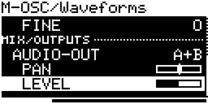

 * **AUDIO-OUT**
   * `-`, `A`, `B`, `C`, `D`, `A+B`, `C+D`
     - The option `-` (no output) is useful if the signal is to be routed into an AUDIO_PROCESSOR engine
     - `A+B` / `C+D`: stereo engines play in stereo, mono engines on both outputs
 * **PAN**: Stereo panning
   - on stereo engines with mono output, panning is also used for mixing
 * **LEVEL**: Output volume level
   - can result in distortion
 * CV-Engines have a `<name>-OUT` row for each CV output instead (`-`, `A`..`D`)
 * Engines that send MIDI (e.g. [MIDI/GM-Drums](app/MIDI/GM-Drums/README.md)) have a **MIDI-OUT** row, like a CV output:
   * `-` (off), `USB` (the USB MIDI to the computer, the default)
   * **CHANNEL**: `APP` (the channel the engine sends on) or `1`-`16` in its place
   * changing either sends All Notes Off on the channels the engine played notes on; so does an engine change
<br clear="right"/>
<div style="page-break-after: always;"></div>

## CLOCK+TIMING+MIDI-Settings

>[Long press [LEFT] + [RIGHT]] opens the menu - turn an encoder to `CLK & MIDI SETTINGS` and press it to get to the CLOCK+TIMING+MIDI-Settings page.

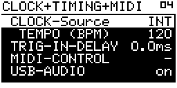

### - **CLOCK-Source**:
   * `-` none
   * `INT` Internal Clock-Source - with an additional row **TEMPO (BPM)**: `30`-`255`
   * `T1` T1 as Clock-Input (4ppqn)
   * `MIDI` Clock received from MIDI
     - the clock pulses move the position (e.g. the steps of `SEQ/...` engines) only between a MIDI Start or Continue and Stop, as in the MIDI spec: without Start they only set the tempo
     - Stop ends the notes of the Midi-Channels (gates off), the pitch stays

> Default Clock-Source for `SEQ/...` engines. <br/>
> Clock-Source is also used by engines like `FX/Delay` (clocked sync) or `SEQ/Clock`


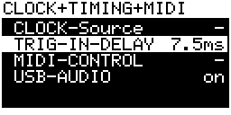

### - **TRIG-In-Delay**: 
   * `0.0ms`-`49.5ms` (0.5 ms steps): Trigger input processing delay. Usecase: sync trig signals with midi or CV<br clear="right"/>

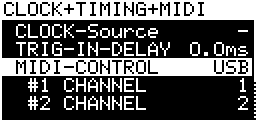

### - **MIDI-Control**:
  - `-` disabled
  - In case OC_T40
    - `USB` the USB-MIDI
    - `USB+T1` [T1 input can be used as MIDI-Input](https://github.com/eh2k/squares-and-circles/wiki/Ornament%E2%80%90and%E2%80%90Crime#-midi-expander)
  - else
    - `MIDI/USB` the USB-MIDI and/or hardware Midi-Input

In case the MIDI-Control is enabled, the row **CHANNELS** sets the Midi-Channels of the engines (switching it on without any channel set gives `1-4`):
  - `1-4` .. `13-16`: one channel per engine, track 1 on the first of the range, track 2 on the next, ...
  - `1 POLY` .. `16 POLY`: all engines on one channel - single mono engines played together polyphonically (shown as voices `1A`, `1B`, ...)
  - `CUSTOM`: a row per engine (**#1 CHANNEL** .. **#4 CHANNEL**: `-`, `1`...`16`)
  - the channels are stored with the patch; with MIDI-Control `-` no engine listens to MIDI notes, CCs and program changes, MIDI engines included
> [Midi-Engines](app/SYNTH/plaits/README.md#midi) consume the MIDI-Stream directly, therefore the MIDI-Messages are not converted as incoming CVs or triggers.

#### Midi-Control
  * Engines can be loaded/selected by midi program change on the engine's channel:
    - the program number is the engine's position on the engine page (`GND/---` = 0), shown at its top (`ENGINE 29`)
    - from 128 on with Bank Select first (CC 0 = 1, program = number - 128); a number past the last engine changes nothing
    - the engine starts with the default I/O (as "Load & reset I/O" on the engine page), the Midi-Channel stays
  * Default Parameter CC-Mappings
    ````
    | HEX | DEC | parameter-index | CH |
    |-----|-----|-----------------|----|
    |  07 |  07 |      LEVEL      |  * |
    |  0A |  10 |       PAN       |  * |
    |  10 |  16 |        0        |  * |
    |  11 |  17 |        1        |  * |
    |  12 |  18 |        2        |  * |
    |  13 |  19 |        3        |  * |
    |  14 |  20 |        4        |  * |
    |  15 |  21 |        5        |  * |
    |  16 |  22 |        6        |  * |
    |  17 |  23 |        7        |  * |
    ````
  > CC 48-55 (HEX 30-37) for LSB (14Bit CC)

* **Midi-Channel** of an engine
  - The Midi messages are translated to analog events
    - Trig: NoteOn
    - Gate: NoteOn until NoteOff
    - CV: 0V = Key 60
  - an engine with a Midi-Channel counts as triggered, as with a TRIG-INPUT: its envelope plays the notes (e.g. `SYNTH/Braids` has `Decay` instead of `Level`), there is no drone without TRIG-INPUT
  - [Multi-Trig-Drum-Engines](https://github.com/eh2k/squares-and-circles/wiki/DrumSynth)
    - In case trigger to `-` - individual drums/instruments are triggered by individual keys:
        - GM Standard Drum Map: https://github.com/eh2k/squares-and-circles/wiki/TR707#midi-mapping
        - keys the drum machine does not map are silent (an app without a key map: keys 60-75 for instrument 1-16)
        
### - **USB-Audio**:
  - `on` (default), `off` - DSM0 and O_C T4.0, stored in the module (not in the patch)
  - The module is also a USB sound card (48 kHz, 16 bit, stereo; class compliant, no driver needed):
    - Recording: the stereo sum of all engines (with level and pan, -6 dB headroom)
    - Playback: AUX-Input `USB` of AUDIO_PROCESSOR engines
  - Switching it takes effect at once: the module reconnects to the computer, with or without the sound card

# Patch Storage
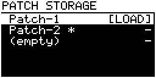

> [Long press `L-ENC + R-ENC`] to enter the patch storage page


* Use `L-ENC` for patch slot selection - `*` marks the patch loaded last
* Turn `R-ENC` to choose `[SAVE]` or `[LOAD]`
* Press `R-ENC` - a box asks `SAVE?` / `LOAD?`, press `R-ENC` again to confirm (any other action cancels)
  * Load `(empty)` - restores all engines to `GND/-` 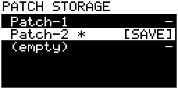
  * Save on `(empty)` adds a new patch slot<br clear="right"/>

# Supported Hardware

 * [Ornament-and-Crime T4.0](https://github.com/eh2k/squares-and-circles/wiki/Ornament%E2%80%90and%E2%80%90Crime)
 * [Squares-and-Circles DSM0](https://github.com/eh2k/squares-and-circles/wiki/Squares&Circles-D_SM-Prototype)
 * [O_C T4.1](https://github.com/eh2k/squares-and-circles/wiki/O_C_T41)

## Hardware setup procedure
  > Use [](https://eh2k.github.io/□●/flash/?firmware)  to enter callibration mode, or execute advanced setup commands </br>
  >Press and hold the [LEFT] button during power-on to enter the setup procedure.

### Display setup

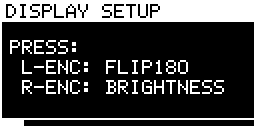

* Press left encoder to flip180.
* Press right encoder for changing display brightness (50%, maximal).<br clear="right"/>

### Encoder setup

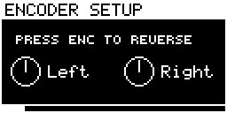

* Check the encoder rotation direction.
* Press encoder for reversed setup.<br clear="right"/>

### DAC calibration

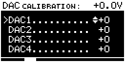

To calibrate the DAC, use a multimeter to accurately set the reference voltages at `0V`, `-2V` and `+2V`.
Start with DAC1 (channel A) - connect the multimeter typically using alligator clip on a patch cable inserted in the jack. Use the right encoder to set the voltage as accurately as possible (press the encoder for coarse adjustment). Do it on all outputs - use the left encoder for channel selection. After calibrating `0V` on all outputs, press [right] to step to the `-2V` calibration. Repeat the procedure and press [right] to calibrating `+2V`.


### ADC calibration

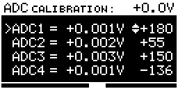

To calibrate the ADC `0V` reference, remove all patch cables from the module. Use the right encoder to adjust the offset (press the encoder for fast adjustment). Do it on all cv-inputs, select the channel with the left encoder. Press [right] to enter the `-2V` calibration. Now you need to connect the DAC outputs to the cv-inputs. The DAC output produces the reference voltage, that is calibrated on the input. Repeat the calibration procedure and step to the `+2V` calibration.

### I/O Test:

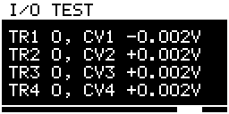

* Test/Verify your TRIG or CV inputs.
* The output voltage is set by the cv input voltage (DACx = ADCx).

<br clear="right"/>

## ⧉ Conclusions and the future

The project started as a kind of personal research in embedded DSP that I did over half a year. At some point, it turned out by chance that the O_C was very well suited for this by only upgrading the Teensy. Apart from the small optional [mod](https://github.com/eh2k/squares-and-circles/wiki/Ornament%E2%80%90and%E2%80%90Crime#optional-dac-voltage-range-mod--5v5v-range) on the DAC voltage range, the current O_C hardware unfortunately has some unchangeable limitations for audio applications. As you know, the Teensy 4.0 doesn't have "high-end" ADCs and a limited amount of RAM. On the other hand, it is the the combination of limitations that make the project unique.

I have mixed feelings about the user interface and the firmware concept. On the one hand, the two buttons and the two encoders are sufficient and actually practical for a multifunction module, but on the other hand, something is missing. Additional buttons/encoders could definitely simplify the operation/interaction - let's see if this [puzzle](https://github.com/eh2k/squares-and-circles/wiki/Squares&Circles-D_SM-Prototype) can be solved.

## License

The application code respectively the suite of machines/engines and the third-party source files are published under permissive software licenses.
For the exact license and copyright holder - see the header of individual source code files or readme/license file in the sub folder.

The firmware as a whole is for personal use only.
If you are considering commercial distributing hardware with this firmware, please contact me (eh2k◯gmx.de).

<!--

````
 _______________
|***************|
|*             *|
|*             *|
|***************|
|               |
| [BL]     [BR] |
|               |
| (EL)     (ER) |
|               |
|( ) ( ) ( ) ( )|
|               |
|( ) ( ) ( ) ( )|
|               |
|( ) ( ) ( ) ( )|
|_______________|
````
-->
