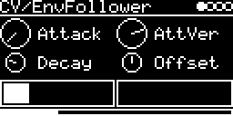

# CV/EnvFollower

Turns an audio signal into a control voltage, to drive a filter or VCA from the level of a drum loop, a voice or
another engine. Two models from the Mutable Instruments Streams code ([lib/streams](../../../lib/streams/)) in one
binary:

| Engine | |
|---|---|
| **CV/EnvFollower** | envelope follower: three frequency bands, peak detection, separate rise and fall smoothing |
| **CV/Vactrol** | vactrol (the light-dependent resistor of a low-pass gate): slow response with a memory effect ([screenshot](EnvFollower_vactrol.png)) |

Both have the same knobs and screen.

## Parameters

| Knob | Range | Default | |
|---|---|---|---|
| **Attack** | 0 ... 127 | 0 | how fast the output rises |
| **AttVer** | -1 ... +1 | 0.5 | attenuverter, negative inverts. The envelope is 0 ... 10.7 V before this |
| **Decay** | 0 ... 127 | 31 | how fast the output falls |
| **Offset** | -5 V ... +5 V | 0 V | added after AttVer |

Left encoder: Attack, Decay. Right encoder: AttVer, Offset. The left box shows the input level, the right one the
envelope over the last 1.6 s.

Approximate times over the knob range:

| | Attack | Decay | Decay at default |
|---|---|---|---|
| EnvFollower, low band | 1.3 ms ... 128 ms | 13 ms ... 1.3 s | 41 ms |
| EnvFollower, mid band | 0.9 ms ... 90 ms | 9 ms ... 0.9 s | 28 ms |
| EnvFollower, high band | 0.07 ms ... 64 ms | 38 ms ... 3.8 s | 119 ms |
| Vactrol | 6.5 ms ... 0.64 s | 13 ms ... 7.6 s | 63 ms |

(The comments in the Streams code give the times of the Streams module, these are the ones at 48 kHz.)

## Inputs and outputs

- Input: **AUX-INPUT** (a jack or `USB`) or the **#&lt;track&gt; &lt;engine&gt;** levels of other tracks, left channel
  only.
- Output: one CV, routed on the I/O page.

With an AUX-INPUT chosen, **AUX-LEVEL** below it sets its level; on a fresh track it starts at 0 (silent), so turn it
up. Inserting other tracks works normally.

## How it works

The follower splits the input into low, mid and high bands with two state-variable filters. Each band has a peak
detector and a one-pole filter with separate attack and decay. The lower bands rise slower, the high band falls
slowest. The sum goes through a square root, so the output follows amplitude, not power.

The vactrol only reacts to the positive half of the input. Rising edges pass at once, so a short trigger is enough to
"pluck" it. Two lag stages follow, with faster coefficients depending on direction. A strong signal builds up a
memory over ~0.3 s that decays over ~39 s; while the memory is low, the attack is up to 5 times faster. A Gompertz
curve maps the state to the output.

Code 11 KB, RAM 636 bytes.

## License and credits

- `EnvFollower.cpp`: © 2021 E.Heidt, MIT license (see [License](../../../README.md#license)).
- [lib/streams](../../../lib/streams): Mutable Instruments Streams, © Emilie Gillet, MIT license.
