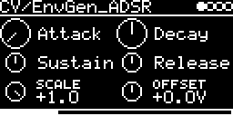

# CV/EnvGen

Envelope generators for CV, an AD and an ADSR, both based on the multistage envelope of Mutable Instruments Peaks
([lib/peaks/modulations/multistage_envelope.cc](../../../lib/peaks/modulations/multistage_envelope.cc)). Triggered
from the trigger input or by MIDI notes.

| Engine | |
|---|---|
| **CV/EnvGen_AD** | attack and decay, runs through on every trigger regardless of gate length |
| **CV/EnvGen_ADSR** | attack, decay, sustain, release, holds the sustain level while the gate is high |

## Parameters

CV/EnvGen_AD:

| Knob | Range | Default | |
|---|---|---|---|
| **Attack** | 0.5 ms ... 7.9 s | 0.5 ms | |
| **Decay** | 0.5 ms ... 7.9 s | 387 ms | |
| **Scale** | -2.0 ... +2.0 | +1.0 | level, 1.0 = 5.3 V peak, 2.0 = 10.7 V. Negative inverts |
| **Offset** | -5 V ... +5 V | 0 V | |

Left encoder: Attack, Scale. Right encoder: Decay, Offset. Below the knobs the envelope shape is drawn with the
current position.

CV/EnvGen_ADSR:

| Knob | Range | Default | |
|---|---|---|---|
| **Attack** | 0.5 ms ... 7.9 s | 0.5 ms | |
| **Decay** | 0.5 ms ... 7.9 s | 387 ms | fall time to the sustain level |
| **Sustain** | 0 ... 100 % | 50 % | |
| **Release** | 0.5 ms ... 7.9 s | 387 ms | |
| **Scale** | -1.0 ... +1.0 | +1.0 | level, 1.0 = 5.3 V peak. Negative inverts |
| **Offset** | -5 V ... +5 V | 0 V | |

Left encoder: Attack, Sustain, Scale. Right encoder: Decay, Release, Offset.

The time knobs show 0 ... 127 and are roughly exponential: 36 ms at a quarter, 0.4 s at half, 2.2 s at three
quarters.

## Inputs and outputs

- **TRIG-INPUT**: a trigger starts the attack. For the ADSR the gate (trigger input held high, or a MIDI note held
  on the track's channel) holds the sustain, and releasing it starts the release.
- One CV output, routed on the I/O page.

## Notes

- The AD has exponential attack and decay. The ADSR has a steeper (quartic) attack and exponential decay and release.
- A new trigger restarts the attack from the current level, not from 0.
- With short trigger pulses the ADSR goes into release right away and the attack gets cut short. Use gates or MIDI
  notes for the ADSR.
- The drawn shape is not to scale in time.
- The screensaver draws the envelope full screen.

Code 7.2 KB, RAM 296 bytes.

## License and credits

- `EnvGen.cpp`: © 2021 E.Heidt, MIT license (see [License](../../../README.md#license)).
- [lib/peaks](../../../lib/peaks): Mutable Instruments Peaks, © Emilie Gillet, MIT license.
