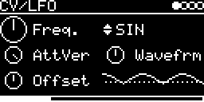

# CV/LFO

LFO for CV, taken from Mutable Instruments Peaks ([lib/peaks/modulations/lfo.cc](../../../lib/peaks/modulations/lfo.cc)).
Five shapes, each with a shape control, and phase reset from the trigger input.

## Parameters

| Knob | Range | Default | |
|---|---|---|---|
| **Freq.** | 0.031 Hz ... 160 Hz | 2.24 Hz | exponential |
| **Shape** | SIN, TRI, SQR, STEPS, NOISE | SIN | |
| **AttVer** | -0.5 ... +0.5 | +0.5 | amplitude, ±5.3 V at +0.5. Negative inverts |
| **Wavefrm** | 0 ... 127 | 64 | depends on Shape, see below |
| **Offset** | -5 V ... +5 V | 0 V | |

Left encoder: Freq., AttVer, Offset. Right encoder: Shape, Wavefrm. The bottom right corner shows a scrolling trace
of the output.

### Wavefrm

| Shape | 0 | center | 127 |
|---|---|---|---|
| **SIN** | blends into a different (wav_fold_power) table | sine | blends into a wave-folded sine, more folding toward 127 |
| **TRI** | falling ramp | triangle | rising ramp |
| **SQR** | very short pulse | square | very short gap (pulse width) |
| **STEPS** | stepped triangle, 2 levels | 9 levels | 16 levels |
| **NOISE** | random steps (sample and hold) | linear ramps between random values | smooth ramps |

## Inputs and outputs

- **TRIG-INPUT**: a trigger, or a MIDI note on the track's channel, restarts the cycle at phase 0.
- One CV output, routed on the I/O page.

Code 11 KB, RAM 512 bytes.

## License and credits

- `LFO.cpp`: © 2021 E.Heidt, MIT license (see [License](../../../README.md#license)).
- [lib/peaks](../../../lib/peaks): Mutable Instruments Peaks, © Emilie Gillet, MIT license.
