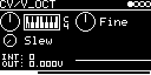

# CV/V_OCT

Pitch CV source. Outputs the track's pitch as the firmware computes it (V/OCT input through the quantizer, MIDI notes
and pitch bend, transpose) plus a voltage set with a piano knob and a fine tune, with optional slew. Use it as a
MIDI-to-CV converter, a quantizer for an external CV, a glide, or a fixed voltage.

## Parameters

| Knob | Range | Default | |
|---|---|---|---|
| **V_OCT** | -4 V ... +4 V | 0 V | voltage added to the output, in semitones (piano display) |
| **Fine** | -128 ... +127 | 0 | ±4 semitones, a step is 1/32 semitone |
| **Slew** | 0 ... 0.5 | off | glide: about 1 ms at 0.1, 17 ms at 0.3, 0.5 s at 0.5 |

Left encoder: V_OCT, Slew. Right encoder: Fine. Below the knobs: `INT` (the pitch before slew, 1536 per volt), `OUT`
(the output in volts) and a scrolling trace.

## Inputs and outputs

- **V/OCT-INPUT** with QUANTIZER, ROOT, TRANSPOSE and FINE from the I/O page. MIDI notes on the track's channel
  (MIDI 60 = 0 V) and pitch bend are added.
- One CV output, **VOCT**, routed on the I/O page.

With everything at zero the output is 0 V. The output is updated once per 0.5 ms block.

Code 1.7 KB, RAM 148 bytes.

## License and credits

- `V_OCT.cpp`: © 2021 E.Heidt, MIT license (see [License](../../../README.md#license)).
