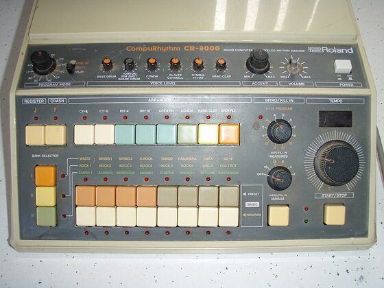

# DRUMKITS/CR-8000

An emulation of the Roland CR-8000 CompuRhythm for [DrumSynth](../DrumSynth/README.md), fully synthesized, every
instrument fitted to a recording of the real machine.

| Instrument | Note | Instrument | Note |
|---|---|---|---|
| BD8000 bass drum | 36 | MC8000 conga | 63 |
| RS8000 rim shot | 37 | CB8000 cowbell | 56 |
| SD8000 snare drum | 38 | CL8000 claves | 75 |
| CP8000 hand clap | 39 | CH8000 closed hi-hat | 42 |
| LT8000 low tom | 41 | OH8000 open hi-hat | 46 |
| MT8000 mid tom | 45 | CY8000 cymbal | 49 |
| HT8000 high tom | 48 | | |

Most instruments are within 1-4 dB of the recordings per band and time window (mean about 3.7 dB). The hats and
cymbal are a bit more noise-like than the original. The recordings are cut short (BD 274 ms, SD 144 ms), so the
tails of those were only compared as far as the files go.

## How it was made

Sources: the recordings in <https://github.com/geikha/tidal-drum-machines>, folder `machines/RolandCompurhythm8000`
(one hit per instrument). The conga file doesn't say which conga it is; at 304 Hz it is mapped to the mid conga.

The method is the same as for the TR-808 kit: measure pitch curve, RMS envelope, 1/3 octave spectra per time window
and partials, build the instrument from the engine's parts with those numbers, render, compare to the recording and
adjust. Later passes fitted filters and levels by least squares on the spectrogram. Levels are set by the loudest
10 ms RMS, peaks stay below 0.9.

- BD8000: sine at 59.5 Hz with a short first cycle at about 86 Hz (the attack), two waveshapers cross faded at
  10 ms for the harmonics, a little low noise.
- SD8000: a 234 Hz tone falling to about 227 Hz, two drum modes at 163 and 264 Hz, and bright noise held for 45 ms,
  then gated.
- RS8000: not a click like the 808's. The recording is a train of clicks repeating every 16.7 ms, each ringing
  resonances at 1257 and 940 Hz plus a broad band at 1-2.5 kHz. Modelled with all 36 clicks explicit, so every hit
  sounds the same.
- CP8000: three noise bursts at 5, 15 and 25 ms, then a dark and a bright tail to about 400 ms. A soft limiter in
  the burst part catches the rare noise peaks.
- LT8000 / MT8000 / HT8000: sines with a short pitch drop (LT 108 -> 101.6 Hz, MT about 145 -> 138 Hz, HT 203 ->
  196 Hz), harmonics and some noise. The recordings have crosstalk between the toms (the MT contains the LT at
  -13 dB), which is kept.
- MC8000: a pure 304 Hz sine with a second mode at 232 Hz in the first 150 ms.
- CB8000: two square waves at 552 and 817 Hz, like the TR-808 cowbell (557 / 824 Hz).
- CL8000: 2361 -> 2310 Hz with its 2nd and 3rd harmonic, about 27 ms long.
- CH8000 / OH8000 / CY8000: six square waves at 162.68, 359.27, 419.22, 519.0, 707.18 and 833.71 Hz, found from the
  recordings' partials, plus noise, with filters and envelopes fitted per instrument. The closed hat's noise goes
  through an expander to get the spikier attack of the original.

## License and credits

- `hardware.jpg`: Photo: Blair Rideout, [CC BY 2.0](https://creativecommons.org/licenses/by/2.0), via [Wikimedia Commons](https://commons.wikimedia.org/wiki/File:Roland_CR-8000_CompuRhythm.jpg) (not part of the MIT license).
- The kit is played by [DrumSynth](../DrumSynth/README.md) (`lib/drumsynth`, © E.Heidt, MIT license, see [License](../../../README.md#license)).
