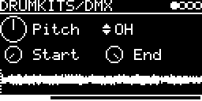

# DRUMKITS/DMX

The Oberheim DMX (1981), played from the factory EPROMs of its 8 voice cards: 16 instruments in one multi-trig
engine, with a common pitch, V/OCT and start/end window, and a level and pan per instrument. Sample rates, decays and
the split ROMs follow the MAME driver ([oberheim/dmx.cpp](https://github.com/mamedev/mame/blob/master/src/mame/oberheim/dmx.cpp)).

## ROMs

The ROMs are flash blobs, one per voice card, not part of the app:

| Blob | Voice card | Chip(s) | Size |
|---|---|---|---|
| `DMXBASS` | Bass | `21KICK.BIN` | 4 KB |
| `DMXSNARE` | Snare | `SNARE6.BIN` | 4 KB |
| `DMXHIHAT` | Hi-Hat | `HAT1A.BIN` | 4 KB |
| `DMXTOM1` | Tom 1 (small toms) | `STOM5.BIN` | 4 KB |
| `DMXTOM2` | Tom 2 (large toms) | `SFLTOM2.BIN` | 4 KB |
| `DMXPERC1` | Perc 1: rimshot, tambourine | `STIK.BIN` | 4 KB |
| `DMXPERC2` | Perc 2: claps, shaker | `SHAKE6.BIN` | 4 KB |
| `DMXCYMB` | Cymbal: crash, ride | `CRASH1.BIN` ... `CRASH4.BIN` + `RIDE2A1.BIN` ... `RIDE2A4.BIN`, one after the other | 32 KB |

The chips are in [Stock DMX Sounds EPROM.zip](https://dbwbp.com/synthbin/Stock%20DMX%20Sounds%20EPROM.zip) and [Standard DMX Cymbals Sound EPROM.zip](https://dbwbp.com/synthbin/Standard%20DMX%20Cymbals%20Sound%20EPROM.zip) (dbwbp.com; the dumps of
[electrongate.com](https://www.electrongate.com/dmxfiles/eproms.html), "for your own personal use"); their CRC32s
are those of MAME's set `obdmx`.
Download the two zips and pick them with **LIBRARY → Extras → Drum ROMs → DMX**; the web app sends the 8 blobs.

Like on the DMX, a card slot takes other chips too: any blob under the card's name is played whole (a 2764 of the DX
too), on the split cards (Perc 1, Perc 2, Cymbal) as two halves.

## Parameters

| Knob | Range | Default | |
|---|---|---|---|
| Pitch | -2 ... +2 octaves | 0.5 (original) | playback speed of all instruments, plus V/OCT |
| *(instrument)* | BASS ... CRASH | BASS | multi-trig selector |
| Start | 0 ... 1 | 0 | start position in the sample |
| End | 0 ... 1 | 1 | end position. Below Start the sample plays backwards |

Left encoder: Pitch, Start. Right encoder: instrument (only while TRIG-INPUT is patched), End.

With TRIG-INPUT set to `-` the selector shows one box per instrument (two rows of 8) that lights up when it plays.
Below the knobs is the sample of the selected (or last played) instrument with Start, End and the play position.
If its card's blob is missing, `ROMS NOT FOUND:` and the missing blob names are shown instead.

### Instruments

| # | Name | DMX button | Card | MIDI keys |
|---|---|---|---|---|
| 1 | BASS | BASS 3 | Bass | 35, 36 |
| 2 | SNARE | SNARE 3 | Snare | 38, 40 |
| 3 | RIMSHOT | RIMSHOT | Perc 1, first half | 37 |
| 4 | CLAPS | CLAPS | Perc 2, first half | 39 |
| 5 | TAMB | TAMB 1/2 | Perc 1, second half | 54 |
| 6 | SHAKE | SHAKE 1/2 | Perc 2, second half | 69, 70 |
| 7 | CH | HI-HAT CLOSED | Hi-Hat | 42, 44 |
| 8 | OH | HI-HAT OPEN | Hi-Hat | 46 |
| 9 | TOM1 | TOM 1 | Tom 1 | 50 |
| 10 | TOM2 | TOM 2 | Tom 1 | 48 |
| 11 | TOM3 | TOM 3 | Tom 1 | 47 |
| 12 | TOM4 | TOM 4 | Tom 2 | 45 |
| 13 | TOM5 | TOM 5 | Tom 2 | 43 |
| 14 | TOM6 | TOM 6 | Tom 2 | 41 |
| 15 | RIDE | CYMB 1/2 | Cymbal, second half | 51, 53, 59 |
| 16 | CRASH | CYMB 3 | Cymbal, first half | 49, 55, 57 |

MIDI keys not in the table are silent.

The DMX has 3 triggers per card, 24 sounds. On most cards they only differ in level, so here every instrument plays
at full level and the level comes from the hit (velocity, LEVEL on the I/O page). The tom cards play one ROM at
three pitches. The hi-hat's ACCENT is left out (OH with CC 4 comes close).

## Inputs and outputs

- TRIG-INPUT patched: the trigger and any MIDI note on the track's channel play the selected instrument.
- TRIG-INPUT `-`: each instrument gets its own `TRIG(BASS)` ... `TRIG(CRASH)`, LEVEL and PAN on the I/O page, and its
  MIDI keys (General MIDI drum map, table above).
- Trigger hits play at full level, MIDI notes follow the velocity.
- V/OCT-INPUT is added to Pitch.
- MIDI CC 4 sets the open hat's decay.
- Stereo output.

One sound per card, as on the DMX: a hit stops the other sounds of its card (CH and OH, the three toms of a card,
RIMSHOT and TAMB, CLAPS and SHAKE, RIDE and CRASH). The 8 cards play at the same time.

Hi-hats: CH plays at 0.826 level with a short decay (15 ms). OH decays by 1 - CC4/127, so with CC 4 at 0 it plays the
whole sample like the DMX's open hat.

## How it works

One sample player per instrument with Hermite interpolation. The DMX stores 8-bit codes for an AM6070 companding
DAC; they are expanded with the AM6070's antilog table. Each card is clocked by a 555 timer: 27.2 kHz on most cards,
40.8 kHz on the snare, 19.1 kHz on Perc 2; the tom cards' triggers shift it to 36.8 and 31.3 kHz. Bass, closed hat
and toms get the RC decay of their cards (27.4, 12.7 and 56.4 ms, starting after 64 samples). At the original pitch a
4 KB ROM lasts about 150 ms, ride and crash 0.6 s each.

The analog parts of the cards (reconstruction filters, the VCA's exact curve, the trimmers) are not modelled. The
engine ([eprom_kit.h](../eprom_kit.h)) is shared with [Linn](../Linn/README.md).

Code 3.9 KB, RAM 504 bytes, plus 16 sample players on the heap (13.6 KB).

## License and credits

- `DMX.cpp`: © E.Heidt, MIT license (see [License](../../../README.md#license)).
- Sample data: the EPROMs of the Oberheim DMX ([Stock DMX Sounds EPROM.zip](https://dbwbp.com/synthbin/Stock%20DMX%20Sounds%20EPROM.zip), [Standard DMX Cymbals Sound EPROM.zip](https://dbwbp.com/synthbin/Standard%20DMX%20Cymbals%20Sound%20EPROM.zip)).
