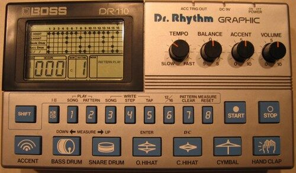

# DRUMKITS/DR-110

An emulation of the Boss DR-110 Dr. Rhythm Graphic (1983) for [DrumSynth](../DrumSynth/README.md): all 7 instruments,
fully synthesized and fitted to recordings of a DR-110.

| Instrument | Note | Instrument | Note |
|---|---|---|---|
| BD110 bass drum | 36 | OH110 open hi-hat | 46 |
| SD110 snare drum | 38 | CR110 crash | 49 |
| CP110 hand clap | 39 | RD110 ride | 51 |
| CH110 closed hi-hat | 42 | | |

The instruments are within 1-3 dB of the recordings per band and time window (mean about 3.5 dB). The hats and
crash are a little spikier than the original (a higher crest factor), and the clap's tail has a bit too much
around 400-500 Hz.

## How it was made

Sources: the recordings in <https://github.com/geikha/tidal-drum-machines>, folder `machines/BossDR110` (one hit per
instrument). The bass drum and snare files have low rumble and the bass drum file ends at 160 ms, so those two were
compared only over their first 70 / 100 ms.

Same method as the TR-808 kit: measure pitch, RMS envelope, 1/3 octave spectra per time window and partials, build
the instrument from the engine's parts with those numbers, render, compare and adjust. Later passes fitted filters
by least squares on the spectrogram. Levels are set by the loudest 10 ms RMS, peaks stay below 0.9.

- BD110: a 51.5 Hz sine without sweep, but with a fast pitch drop in the first 18 ms for the trigger pulse. The
  level is fitted half period by half period, about -0.5 dB/ms. A short noise click.
- SD110: a 252 Hz tone decaying at about 1 dB/ms, and noise high passed at 1.2 kHz.
- CP110: three noise bursts at 0, 12.5 and 24 ms, the fourth runs into the tail (0.7-1.4 kHz, to about 470 ms) plus
  a brighter tail that is gone by 300 ms. A soft limiter in the burst part catches the rare noise peaks.
- CH110 / OH110 / CR110: one oscillator bank for all cymbals. The partials of the recordings are harmonics of five
  oscillators at 263.6, 305.5, 461.2, 816.8 and 1120.1 Hz, with even and odd harmonics, so they are saw waves. The
  saws plus white noise go through two high passes (the spectrum peaks at 6.3 kHz). The open hat gets a short noise
  click, the crash has a linear decay to about 1 s and the saws start at different phases to keep the peaks down.
- RD110: the same saws with a slower decay, a stick transient, square waves at 816.8 and 1120.1 Hz for the band
  around 3.3 kHz, and some noise at 1-2 kHz.

## License and credits

- `hardware.jpg`: Photo: Extra drowsy Formula, [CC BY-NC-SA 2.0](https://creativecommons.org/licenses/by-nc-sa/2.0/), via [Flickr](https://www.flickr.com/photos/38232643@N05/3517472919) (not part of the MIT license; non-commercial use only).
- The kit is played by [DrumSynth](../DrumSynth/README.md) (`lib/drumsynth`, © E.Heidt, MIT license, see [License](../../../README.md#license)).
