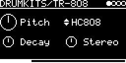

# DRUMKITS/DrumSynth



A drum machine for synthesized drum kits in the style of the RC-808 drum synth. Each kit is a flash blob in the `!RC8`
format of [lib/drumsynth](../../../lib/drumsynth/drumsynth.cpp) (3 to 7 KB) and shows up as an engine of its own.
A kit has up to 16 instruments, all played in one stereo multi-trig engine with a level and pan per instrument.

## Kits

Every flash blob starting with `!RC8` becomes an engine. The menu name is the blob name without extension, with
`DRUMKITS/` in front if it has no `/` of its own (max. 19 characters). The kits are stored as `DRUMKITS/<kit>.rc8`
([upload.py](../../upload.py) does that). The kits in the repository and their MIDI notes:

| Engine | Instruments |
|---|---|
| DRUMKITS/CR-78 | BD78 (36), SD78 (38), RS78 (37), CH78 (42), OH78 (46), CB78 (56), CL78 (75), TB78 (54), GU78 (73), GU78L (74), MB78 (80), BH78 (60), BL78 (61), LC78 (64) |
| DRUMKITS/CR-8000 | BD8000 (36), SD8000 (38), RS8000 (37), CP8000 (39), LT8000 (41), MT8000 (45), HT8000 (48), MC8000 (63), CB8000 (56), CL8000 (75), CH8000 (42), OH8000 (46), CY8000 (49) |
| DRUMKITS/DR-110 | BD110 (36), SD110 (38), CP110 (39), CH110 (42), OH110 (46), CR110 (49), RD110 (51) |
| DRUMKITS/KR-55 | BD55 (36), SD55 (38), MT55 (45), LC55 (64), RS55 (37), CB55 (56), CL55 (75), CH55 (42), OH55 (46), CY55 (49) |
| DRUMKITS/MFB-512 | BD512 (36), SD512 (38), LT512 (41), MT512 (45), HT512 (48), CP512 (39), CH512 (42), OH512 (46), CR512 (49) |
| DRUMKITS/TR-606 | BD606 (36), SD606 (38), LT606 (41), HT606 (48), CH606 (42), OH606 (46), CY606 (49) |
| DRUMKITS/TR-808 | BD808 (36), SD808 (38), LT808 (41), MT808 (45), HT808 (48), LC808 (64), MC808 (63), HC808 (62), RS808 (37), CP808 (39), CB808 (56), CL808 (75), MA808 (70), CH808 (42), OH808 (46), CY808 (49) |
| DRUMKITS/TR-909 | BD909 (36), SD909 (38), LT909 (41), MT909 (45), HT909 (48), RS909 (37), CP909 (39), CH909 (42), OH909 (46), CR909 (49), RD909 (51). Hats and cymbals need the TR-909 ROMs, see Notes |

The screenshot shows the TR-808 kit.

## Parameters

| Knob | Range | Default | |
|---|---|---|---|
| Pitch | 0.5 ... 1.5 | 1 | scales all frequencies of the kit (oscillators, filters, sample rates), V/OCT on top |
| *(instrument)* | the kit's instruments | first | multi-trig selector |
| Decay | 0.1 ... 2 | 1 | scales the envelope tails; attacks keep their timing |
| Stereo | 0 ... 1 | 0.5 | width of the filtered noise parts, 0 is mono [ I like stereo ;-) ] |

Left encoder: Pitch, Decay. Right encoder: instrument (only while TRIG-INPUT is patched), Stereo.

With TRIG-INPUT set to `-` the selector shows one box per instrument (two rows of 8) that lights up when it plays.

## Inputs and outputs

- TRIG-INPUT patched: the trigger and any MIDI note on the track's channel play the selected instrument. The MIDI
  key also transposes (60 = no change).
- TRIG-INPUT `-`: each instrument gets its own `TRIG(<name>)` entry, LEVEL and PAN on the I/O page, and its MIDI note
  from the kit. Keys don't transpose then.
- V/OCT-INPUT transposes the whole kit.
- Trigger hits play at full level, MIDI notes follow the velocity.
- MIDI CC 4 sets the open hat's decay.

MIDI keys: notes 35 ... 59 are used as they are. If a kit has only one of a pair, both keys play it: 35/36 (BD),
38/40 (SD), 42/44 (closed hat), 41/43, 45/47, 48/50 (toms). The cymbals in two groups, crash 49/55/57 and ride
51/53/59: the empty keys of a group play the group's cymbal (the first of 49, 57, 55 or of 51, 59, 53), a group
without one the other group's, so a kit with one cymbal plays it on all six keys. Notes outside 35 ... 59 are mapped
too. Other keys are silent.

Hi-hats: the instrument on key 46 is the open hat, instruments on 42 or 44 choke it. Its decay is
0.1 + Decay · (1 - CC4/127), so with CC 4 at 0 it's the normal decay and at 127 very short.

## How it works

Each instrument is made of a few parts:

```
OSC -> osc amp envelope -> FILTER -> VCF -> VCA envelope -> level
 ^ pitch envelope

FILTER, serial:    biquad 1 -> waveshaper -> biquad 2
FILTER, parallel:  (biquad 1 + biquad 2) -> waveshaper
```

Oscillators are sine, saw, triangle and square (from Plaits), metallic (several square waves with exponentially spaced
frequencies, summed), stereo noise, and samples from flash blobs. The filters are Nigel Redmon's biquads, the waveshaper a
spline curve as in RC-808.exe, the VCF a Chamberlin lowpass as in the original RC-808 (up to 7.3 kHz). Envelopes are
breakpoints with exponential segments. Instruments are summed without a limiter, and each stops 5.5 s after its
trigger.

## Notes

- Samples: the repository's TR-909 kit plays CH909 and OH909 from the blob `909_HIGH`, CR909 from `909_CRASH` and
  RD909 from `909_RIDE`. Without those blobs these four instruments are silent. Download
  [eproms_9090.zip](http://www.synthdiy.com/files/2006/eproms_9090.zip) (`HiHats.bin`, `Crash.bin`, `Ride.bin`) and send them with **LIBRARY → Extras → Drum ROMs → TR909**.
- The oscillator types NOISE3, NES noise and SID noise render silence.
- Max. 16 instruments per kit.
- The format packs the parts since 2026-10 (a third of the old size, see
  [drumsynth](https://github.com/eh2k/drumsynth)). Older kits load no instruments and stay silent: open the `.json`
  in the drumsynth web app and save or flash it again.

Code 20 KB, RAM 800 bytes.

## License and credits

- `DrumSynth.cpp`: © 2024 E.Heidt, MIT license (see [License](../../../README.md#license)).
- `../../../lib/drumsynth` by E.Heidt, MIT license.
- helpers in `../../../lib/misc`: Biquad by Nigel Redmon (EarLevel Engineering), biquad.hpp by KORG (BSD 3-Clause), others see the headers.
- [lib/plaits](../../../lib/plaits): Mutable Instruments Plaits, © Emilie Gillet, MIT license.
