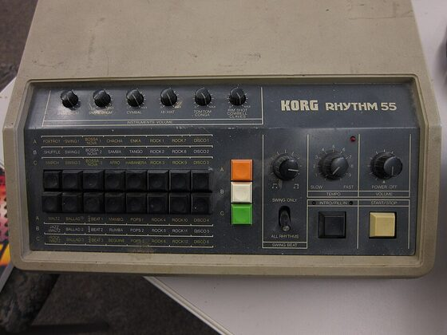

# DRUMKITS/KR-55

An emulation of the Korg KR-55 (Rhythm 55) for [DrumSynth](../DrumSynth/README.md): its 10 instruments,
synthesized from measurements of KR-55 recordings.

| Instrument | Note | Instrument | Note |
|---|---|---|---|
| BD55 bass drum | 36 | CB55 cowbell | 56 |
| SD55 snare drum | 38 | CL55 claves | 75 |
| RS55 rim shot | 37 | CH55 closed hi-hat | 42 |
| MT55 tom | 45 | OH55 open hi-hat | 46 |
| LC55 conga | 64 | CY55 cymbal | 49 |

The KR-55 has only one tom and one conga; by pitch (147 and 193 Hz) they sit on the mid tom and low conga notes.
The kit is the flash blob `DRUMKITS/KR-55.rc8`. On average it is about 3.3 dB off the recordings (spectra and
envelopes).

## How it was made

Recordings from <https://github.com/geikha/tidal-drum-machines>, folder `machines/KorgKR55` (44.1 kHz, one hit per
instrument). The files are short (claves 27 ms, snare 221 ms, bass drum 377 ms, cymbal 1.07 s), so the comparison
ends where they end.

Same method as the [TR-808](../TR-808/README.md#method). Two things mattered more here: the waveform of the first
milliseconds (the bass drum's click is the first quarter wave of the tone itself, the tom and conga start at a zero
crossing), and the peak-to-RMS ratio of the hats, because the KR-55 clips the sum of its square waves.

- BD55: sine 56.5 Hz that starts fast (a quarter wave at about 170 Hz, heard as the click, then 85 -> 70 -> 56.5 Hz
  within 25 ms), a soft asymmetric waveshaper, LP 1 kHz, a noise click and a low noise along the decay. Decay about
  -0.18 dB/ms.
- SD55: a 245 Hz tone (starting at 202 Hz) with a short 2nd harmonic, noise HP 500 Hz -> LP 9 kHz held for 40 ms,
  and a low noise below the tone.
- MT55: 147 Hz falling slowly to 127 Hz over 375 ms, with its 2nd, 3rd and 5th harmonic, a membrane mode at 1.35x,
  and a short click around 800 Hz.
- LC55: 193 Hz falling to 183 Hz, with its 3rd harmonic, modes at 0.835x and 1.22x, a slower decaying mode around
  122 Hz, a click and a short low thump.
- RS55: a 482 Hz square wave low passed at 4.5 kHz (the harmonics gone after 10 ms), a sine on the fundamental to
  about 20 ms, and noise HP 3 kHz.
- CB55: a 3827 Hz pulse ring modulated by a 716 Hz pulse (duty 0.46), plus both waves on their own. This uses the
  engine's amp mod (part 0 multiplied by another part).
- CL55: 2468 Hz with its 2nd, 3rd and 5th harmonic, a 2.1 kHz transient and a little noise, about 15 ms.
- CH55 / OH55: six square waves through high passes at 7.6-9 kHz into a soft clipper (which brings the peak/RMS down
  from 13 to about 10 dB like the original, and adds intermodulation partials), plus noise for the part below 7 kHz.
  CH is gone after about 100 ms, OH holds 100 ms and is gone at 300 ms.
- CY55: the two hat parts without the clipper (the cymbal is peakier than the hats), metallic and noise parts for
  the middle band, and a metallic part for the low partials (155-1411 Hz), each with its own envelope. -40 dB at
  about 680 ms, -60 dB at 1 s.

## Engine behaviour worth knowing

- Amp mod: when part 0 modulates with part n, part 0 is multiplied by part n, and part n is not mixed in on its own.
  Both keep their own envelopes and levels.
- The engine's sine starts at its negative peak. A sound that starts at a zero crossing (tom, conga) needs a fade in
  over a quarter period.
- A soft clipper between the two biquads lowers the peak/RMS of summed square waves and adds intermodulation, like a
  distorting mixer.

## License and credits

- `hardware.jpg`: Photo: anders pearson, [CC BY-SA 2.0](https://creativecommons.org/licenses/by-sa/2.0), via [Wikimedia Commons](https://commons.wikimedia.org/wiki/File:Korg_Rhythm_55_(KR-55).jpg) (not part of the MIT license).
- The kit is played by [DrumSynth](../DrumSynth/README.md) (`lib/drumsynth`, © E.Heidt, MIT license, see [License](../../../README.md#license)).
