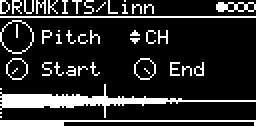

# DRUMKITS/Linn

The LinnDrum (1982, often called LM-2), played from its sample EPROMs: 16 instruments in one multi-trig engine, with
a common pitch, V/OCT and start/end window, and a level and pan per instrument. Voices and the rates of the tunable
ones follow the MAME driver ([linn/linndrum.cpp](https://github.com/mamedev/mame/blob/master/src/mame/linn/linndrum.cpp)).
The engine is the one of [DMX](../DMX/README.md) ([eprom_kit.h](../eprom_kit.h)).

## ROMs

The ROMs are flash blobs, one per ROM, not part of the app:

| Blob | Voice | Chip(s) | Size |
|---|---|---|---|
| `LINNBASS` | Bass | `bass01.bin` (**Linn 9000**) | 8 KB |
| `LINNSNAR` | Snare | `Linndrum_SNARE9.BIN` | 4 KB |
| `LINNSSTK` | Sidestick | `Linndrum_SIDESTICK1.BIN` (first half played, see below) | 4 KB |
| `LINNCLAP` | Claps | `clap0125.bin` (**Linn 9000**) | 8 KB |
| `LINNTAMB` | Tambourine | `Linndrum_TAMB1.BIN` | 4 KB |
| `LINNCABA` | Cabasa | `caba0125.bin` (**Linn 9000**) | 8 KB |
| `LINNCOWB` | Cowbell | `Linndrum_COWBELL1.BIN` | 4 KB |
| `LINNHAT` | Hi-hat | `Linndrum_HAT1A.BIN` ... `HAT1D` (4 chips) | 16 KB |
| `LINNTOM` | Toms | `Linndrum_TOM6A.BIN`, `TOM6B` (2 chips) | 8 KB |
| `LINNCNGA` | Congas | `Linndrum_CONGA1A.BIN`, `CONGA1B` (2 chips) | 8 KB |
| `LINNRIDE` | Ride | `Linndrum_RIDE1A.BIN` ... `RIDE1H` (8 chips) | 32 KB |
| `LINNCRSH` | Crash | `Linndrum_CRASH1A.BIN` ... `CRASH1H` (8 chips) | 32 KB |

The `Linndrum_*` chips are in [Linndrum Factory ROMs.zip](https://dbwbp.com/synthbin/Linndrum%20Factory%20ROMs.zip), the Linn 9000's in [Linn 9000  roms 1.zip](https://dbwbp.com/synthbin/Linn%209000%20%20roms%201.zip) (dbwbp.com).
The LinnDrum chips have the CRC32s of MAME's set `linndrum`. The LinnDrum's bass, claps and cabasa were never dumped,
so the Linn 9000's chips are used for them. The sidestick chip in MAME's set is the DMX's `STIK` (rimshot and
tambourine), so only its first half is played.

Download the two zips and pick them with **LIBRARY → Extras → Drum ROMs → Linn**; the web app sends the 12 blobs. A slot takes another
chip of any length.

## Parameters

| Knob | Range | Default | |
|---|---|---|---|
| Pitch | -2 ... +2 octaves | 0.5 (original) | playback speed of all instruments, plus V/OCT |
| *(instrument)* | BASS ... CRASH | BASS | multi-trig selector |
| Start | 0 ... 1 | 0 | start position in the sample |
| End | 0 ... 1 | 1 | end position. Below Start the sample plays backwards |

Left encoder: Pitch, Start. Right encoder: instrument (only while TRIG-INPUT is patched), End.

With TRIG-INPUT set to `-` the selector shows one box per instrument (two rows of 8) that lights up when it plays.
Below the knobs is the sample of the selected (or last played) instrument with Start, End and the play position.
If its ROM is missing, `ROMS NOT FOUND:` and the missing blob names are shown instead.

### Instruments

| # | Name | LinnDrum button | ROM | MIDI keys |
|---|---|---|---|---|
| 1 | BASS | BASS 1/2 | Bass (L9K) | 35, 36 |
| 2 | SNARE | SNARE 1/2/3 | Snare | 38, 40 |
| 3 | SIDESTK | SIDESTICK | Sidestick, first half | 37 |
| 4 | CLAPS | CLAPS | Claps (L9K) | 39 |
| 5 | TAMB | TAMB 1/2 | Tambourine | 54 |
| 6 | CABASA | CABASA 1/2 | Cabasa (L9K) | 69 |
| 7 | COWBELL | COWBELL | Cowbell | 56 |
| 8 | CH | HIHAT 1/2 | Hi-hat | 42, 44 |
| 9 | OH | HIHAT O | Hi-hat | 46 |
| 10 | HITOM | HI TOM | Toms | 50, 48 |
| 11 | MIDTOM | MID TOM | Toms | 47, 45 |
| 12 | LOTOM | LO TOM | Toms | 43, 41 |
| 13 | HICONGA | HI CONGA | Congas | 62, 63 |
| 14 | LOCONGA | LO CONGA | Congas | 64 |
| 15 | RIDE | RIDE 1/2 | Ride | 51, 53, 59 |
| 16 | CRASH | CRASH | Crash | 49, 55, 57 |

MIDI keys not in the table are silent.

The LinnDrum's buttons 1 and 2 and SNARE 1/2/3 only differ in level. Here every instrument plays at full level and
the level comes from the hit (velocity, LEVEL on the I/O page).

## Inputs and outputs

- TRIG-INPUT patched: the trigger and any MIDI note on the track's channel play the selected instrument.
- TRIG-INPUT `-`: each instrument gets its own `TRIG(BASS)` ... `TRIG(CRASH)` on the I/O page and its MIDI keys
  (General MIDI drum map, table above).
- LEVEL and PAN of each instrument: on the kit's mix page, the page after the parameters (▶), see
  [DrumSynth](../DrumSynth/README.md#mix-page).
- Trigger hits play at full level, MIDI notes follow the velocity.
- V/OCT-INPUT is added to Pitch.
- MIDI CC 4 sets the open hat's decay.
- Stereo output.

One sound per voice, as on the LinnDrum: CH and OH stop each other, snare and sidestick share a voice, and so do the
three toms and two congas.

Hi-hats: CH decays with about 62 ms (the LinnDrum's hold plus decay with its HIHAT DECAY knob in the middle). OH
decays by 1 - CC4/127, so with CC 4 at 0 it plays the whole sample.

## How it works

One sample player per instrument with Hermite interpolation. The ROMs hold 8-bit codes for an AM6070 companding DAC,
expanded with its antilog table. The 8 "mux drums" share one clock, here 28 kHz (the LinnDrum's spec says 28 to
35 kHz, set by a factory trimmer); snare and sidestick also run at 28 kHz (the SNARE tuning knob). Toms and congas use
MAME's rates at its default knob positions: 47.4, 40.8 and 34.3 kHz for the toms, 42.1 and 34.3 kHz for the congas.
At the original pitch a 4 KB ROM lasts 146 ms, the hat 0.59 s, ride and crash 1.17 s.

Not modelled: the filters with envelopes after the bass and the tom/conga voice (CEM3320), the output filters, the
click.

Code 4.0 KB, RAM 524 bytes, plus 16 sample players on the heap (13.6 KB).

## License and credits

- `Linn.cpp`: © E.Heidt, MIT license (see [License](../../../README.md#license)).
- Sample data: the EPROMs of the LinnDrum / Linn 9000 ([Linndrum Factory ROMs.zip](https://dbwbp.com/synthbin/Linndrum%20Factory%20ROMs.zip), [Linn 9000  roms 1.zip](https://dbwbp.com/synthbin/Linn%209000%20%20roms%201.zip)).
