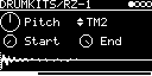

# DRUMKITS/RZ-1

The Casio RZ-1, played from dumps of its two sample ROMs (CM5 and CM6, 32 KB each, signed 8-bit at 20 kHz). One
multi-trig engine for the whole kit, with its own trigger, MIDI keys, level and pan per instrument. Pitch, Start and
End apply to all instruments.

## Parameters

| Knob | Range | Default | |
|---|---|---|---|
| Pitch | -2 ... +2 octaves | 0.5 (original) | playback rate, plus V/OCT |
| TRIGS | BD ... CR | BD | selected instrument |
| Start | 0 ... 1 | 0 | start position in the sample |
| End | 0 ... 1 | 1 | end position. Below Start the sample plays backwards |

Left encoder: Pitch, Start. Right encoder: TRIGS, End.

The display shows the sample of the selected instrument with Start and End as dotted lines. With TRIG-INPUT at `-`,
TRIGS becomes a row of boxes that flash on each hit, and the waveform follows the last instrument hit.

### Instruments

| # | Name | | MIDI keys |
|---|---|---|---|
| 0 | BD | bass drum | 35, 36 |
| 1 | SD | snare | 38, 40 |
| 2 | CP | hand clap | 39 |
| 3 | RM | rim shot | 37 |
| 4 | CB | cowbell | 56 |
| 5 | CLK | metronome click | 33 |
| 6 | TM1 | tom 1 (high, ~150 Hz) | 48, 50 |
| 7 | TM2 | tom 2 (mid, ~125 Hz) | 45, 47 |
| 8 | TM3 | tom 3 (low, ~95 Hz) | 41, 43 |
| 9 | CH | closed hi-hat | 42, 44 (pedal) |
| 10 | OH | open hi-hat | 46 |
| 11 | RD | ride | 51, 53 (bell), 59 (edge) |
| 12 | CR | crash | 49, 55, 57 |

Keys not in the table are silent.

## Inputs and outputs

- TRIG-INPUT patched: the trigger plays the selected instrument. With `-`, each instrument gets its own TRIG(name)
  on the I/O page.
- LEVEL and PAN of each instrument: on the kit's mix page, the page after the parameters (▶), see
  [DrumSynth](../DrumSynth/README.md#mix-page).
- V/OCT-INPUT is added to Pitch, for all instruments.
- MIDI on the track's channel: with TRIG-INPUT at `-` each instrument answers to its keys and velocity sets the
  level. With a TRIG-INPUT source a note plays the selected instrument, transposed from key 60. Pitch bend works,
  CC 4 shortens the open hat.
- Stereo output.

Hi-hats: CH plays at 0.7 level with a short fade (about 18 ms) and chokes OH. OH plays its whole sample (0.6 s);
MIDI CC 4 fades it out sooner (decay 1 - CC/127).

## How it works

Each instrument is a slice of one of the two ROMs, played by the firmware's sample player with Hermite
interpolation. The sample offsets come from R-Massive's RZ-1 ROM hacking article. The longest sounds are the ride
(0.7 s) and crash (0.72 s), the click is 25 ms.

## Notes

- Needs the flash blobs `RZ1_ROMA` (at least 31615 bytes) and `RZ1_ROMB` (at least 32768 bytes).
  Download [Casio RZ-1 Stock PCM ROMs.zip](https://dbwbp.com/synthbin/Casio%20RZ-1%20Stock%20PCM%20ROMs.zip) and send
  them with **LIBRARY → Extras → Drum ROMs → RZ-1**.
- Without one of them the screen shows `ROMS NOT FOUND` and the engine is silent.

Code 3.4 KB, RAM 392 bytes.

## License and credits

- `RZ-1.cpp`: © E.Heidt, MIT license (see [License](../../../README.md#license)).
- Sample data: the ROMs of the Casio RZ-1 ([Casio RZ-1 Stock PCM ROMs.zip](https://dbwbp.com/synthbin/Casio%20RZ-1%20Stock%20PCM%20ROMs.zip)).
