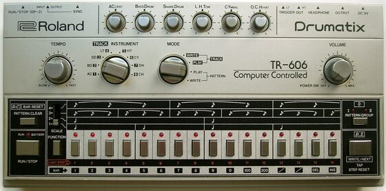

# DRUMKITS/TR-606

An emulation of the Roland TR-606 for [DrumSynth](../DrumSynth/README.md). All 7 instruments, synthesized, with every
parameter fitted to recordings of a real TR-606 (it has no sound knobs, so there is only one sound per instrument).
The kit is the flash blob `DRUMKITS/TR-606.rc8`.

| Instrument | | MIDI note |
|---|---|---|
| BD606 | bass drum | 36 |
| SD606 | snare drum | 38 |
| LT606 | low tom | 41 |
| HT606 | high tom | 48 |
| CH606 | closed hi-hat | 42 |
| OH606 | open hi-hat | 46 |
| CY606 | cymbal | 49 |

It's close: the average deviation from the recordings is about 3 dB (spectrum per time window and envelope). The
models have no hiss, so the noise floor of the recordings is not reproduced, and nothing above 14 kHz was compared
(the recordings are low passed at about 15 kHz).

## How it was made

Sources:

- <https://github.com/geikha/tidal-drum-machines>, folder `machines/RolandTR606` (44.1 kHz, one hit per
  instrument): snare, closed hat and cymbal.
- Bass drum, toms and open hat are fitted to the free "Roland TR-606 samples" of vstplanet.com (the 2016 copy in the
  Internet Archive). They are cleaner and longer than the files above (which are cut short, e.g. the bass drum at
  226 ms, the open hat at 0.49 s). No license is stated, so they are only used as a reference and are not in the
  repository.

Method as for the [TR-808](../TR-808/README.md): measure pitch curve, envelope, 1/3 octave spectra and partials of
each recording, build the instrument from the engine's oscillators, noise, filters, waveshaper and envelopes, render
it, compare with the recording and iterate. Levels are set so that the peaks stay below 0.9 in practice (the noise
differs from hit to hit).

Per instrument:

- BD606: a 54.8 Hz sine through a slightly asymmetric shaper (2nd harmonic), with the pitch starting at about half
  and reaching full by 14 ms, which gives the long first lobe of the original waveform. A short click (low passed
  103 Hz quarter cycle) and two decaying sines at 135 and 126 Hz make the attack components. Decays about 0.2 dB/ms.
- SD606: a sine sweeping 338 -> 208 Hz (time constant 9 ms), noise high passed at 1.7 kHz and low passed at 9 kHz,
  louder against the tone than on the 808, plus four quiet sines (272, 301, 322, 358 Hz) for the drum modes that
  ring on.
- LT606: 157 Hz falling to 129 Hz after 100 ms, with a short trigger pulse (about 1.1 ms) on top of the tone at
  the start and a little 2nd harmonic.
- HT606: 207.7 Hz, starting after the trigger pulse (1.1 ms). A 146 -> 135 Hz component rings along: crosstalk from
  the low tom, present in both recordings, so it belongs to the 606.
- CH606 / OH606 / CY606: six square waves at 362.47, 418.91, 470.7, 585.0, 634.49 and 774.83 Hz (found in all three
  recordings) plus noise, through band and high pass filters fitted per instrument. The open hat rings to about
  1.2 s as on the vstplanet recording, the cymbal to about 1.9 s.

The engine notes for the TR-808 kit apply here too (clipping compresses the envelope, band pass skirts leak, DC
offset of the waveshaper).

## License and credits

- `hardware.jpg`: Photo: Midas Wouters, [CC BY-SA 3.0](https://creativecommons.org/licenses/by-sa/3.0), via [Wikimedia Commons](https://commons.wikimedia.org/wiki/File:Roland_TR-606.jpg) (not part of the MIT license).
- The kit is played by [DrumSynth](../DrumSynth/README.md) (`lib/drumsynth`, © E.Heidt, MIT license, see [License](../../../README.md#license)).
