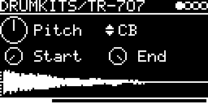

# DRUMKITS/TR-707

The Roland TR-707, played from dumps of its sample ROMs. One multi-trig engine for the whole kit, with its own trigger,
MIDI keys, level and pan per instrument. Pitch, Start and End apply to all instruments.

## Parameters

| Knob | Range | Default | |
|---|---|---|---|
| Pitch | -2 ... +2 octaves | 0.5 (original) | playback rate, plus V/OCT |
| TRIGS | BD0 ... OH (+ RD, CR) | BD0 | selected instrument |
| Start | 0 ... 1 | 0 | start position in the sample |
| End | 0 ... 1 | 1 | end position. Below Start the sample plays backwards |

Left encoder: Pitch, Start. Right encoder: TRIGS, End.

The display shows the sample of the selected instrument with Start and End as dotted lines. With TRIG-INPUT at `-`,
TRIGS becomes a row of boxes that flash on each hit, and the waveform follows the last instrument hit.

### Instruments

| # | Name | | MIDI keys |
|---|---|---|---|
| 0 | BD0 | bass drum 1 | 35 |
| 1 | BD1 | bass drum 2 | 36 |
| 2 | SD0 | snare 1 | 38 |
| 3 | SD1 | snare 2 | 40 |
| 4 | CP | hand clap | 39 |
| 5 | TMB | tambourine | 54 |
| 6 | RM | rim shot | 37 |
| 7 | CB | cowbell | 56 |
| 8 | LT | low tom | 41, 43 |
| 9 | MT | mid tom | 45, 47 |
| 10 | HT | high tom | 48, 50 |
| 11 | CH | closed hi-hat | 42, 44 (pedal) |
| 12 | OH | open hi-hat | 46 |
| 13 | RD | ride (only with `707_IC22`) | 51, 53 (bell), 59 (edge) |
| 13 or 14 | CR | crash (only with `707_IC19`; 13 without the ride) | 49, 55, 57 |

Keys not in the table are silent.

## Inputs and outputs

- TRIG-INPUT patched: the trigger plays the selected instrument. With `-`, each instrument gets its own TRIG(name),
  LEVEL and PAN on the I/O page.
- V/OCT-INPUT is added to Pitch, for all instruments.
- MIDI on the track's channel: with TRIG-INPUT at `-` each instrument answers to its keys and velocity sets the
  level. With a TRIG-INPUT source a note plays the selected instrument, transposed from key 60. Pitch bend works,
  CC 4 shortens the open hat.
- Stereo output.

Hi-hats: both play the same sample. CH plays at 0.7 level with a short fade (about 28 ms) and chokes OH. OH plays to
the end of the sample; MIDI CC 4 fades it out sooner (decay 1 - CC/127).

## How it works

Each instrument is an unsigned 8-bit sample, played by the firmware's sample player with Hermite interpolation. Most
sounds run at 25 kHz, the toms at 12.5 kHz (4096 samples each); ride and crash are 32768 samples at 25 kHz. Some
ROM areas hold two sounds interleaved (even/odd bytes): BD0/BD1, SD0/SD1, RM/CB and CP/TMB.

## Notes

- Needs the flash blobs `707_IC34` and `707_IC35` (at least 32 KB each), and for the cymbals `707_IC22` (ride) and
  `707_IC19` (crash), 32 KB each. Download
  [Roland TR-707 sound ROMs.zip](https://dbwbp.com/synthbin/Roland%20TR-707%20sound%20ROMs.zip) and send them with **LIBRARY → Extras → Drum ROMs → TR707**.
- Without `707_IC34` or `707_IC35` the screen shows `ROMS NOT FOUND` and the engine is silent. Without a cymbal ROM
  that instrument is left out.

Code 3.7 KB, RAM 424 bytes.

## License and credits

- `TR-707.cpp`: © E.Heidt, MIT license (see [License](../../../README.md#license)).
- Sample data: the ROMs of the Roland TR-707 ([Roland TR-707 sound ROMs.zip](https://dbwbp.com/synthbin/Roland%20TR-707%20sound%20ROMs.zip)).
