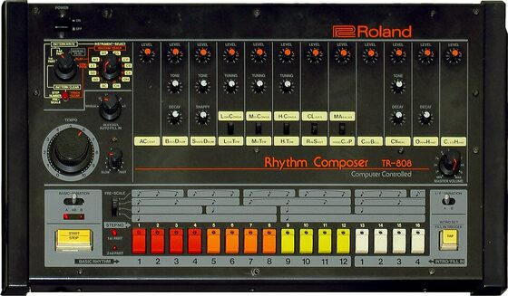

# DRUMKITS/TR-808

An emulation of the Roland TR-808 for [DrumSynth](../DrumSynth/README.md). All 16 instruments are synthesized, no
samples; every parameter was derived from recordings of a real TR-808 at the middle knob settings.

| Instrument | Note | Instrument | Note |
|---|---|---|---|
| BD808 bass drum | 36 | RS808 rim shot | 37 |
| SD808 snare drum | 38 | CP808 hand clap | 39 |
| LT808 low tom | 41 | CB808 cowbell | 56 |
| MT808 mid tom | 45 | CL808 claves | 75 |
| HT808 high tom | 48 | MA808 maracas | 70 |
| LC808 low conga | 64 | CH808 closed hi-hat | 42 |
| MC808 mid conga | 63 | OH808 open hi-hat | 46 |
| HC808 high conga | 62 | CY808 cymbal | 49 |

The kit is the flash blob `DRUMKITS/TR-808.rc8`. It comes close to the recordings: on average the spectra and
envelopes are about 3 dB off, most of that in the first 20 ms of the noisy instruments, which also differ from hit
to hit on the real machine. Congas and claves are the closest.

## How it was made

Recordings from <https://github.com/geikha/tidal-drum-machines>, folder `machines/RolandTR808` (44.1 kHz, one hit
per file, e.g. `bd/BD5050.WAV` = tone 50, decay 50).

### Method

The other kits were made the same way.

1. Measure each recording: pitch over time, the RMS envelope in dB, 1/3 octave spectra in a few time windows,
   the partials, and for hats how tonal the noise is.
2. Build the instrument from the engine's parts (oscillators with a pitch envelope, the six-square "metallic"
   oscillator, noise, two biquads per part with a waveshaper between them, envelopes before and after the filters)
   and put the measured numbers in directly.
3. Render it with the engine at 48 kHz and score it against the recording (resampled to 48 kHz): spectrum shape per
   window and RMS envelope, both in dB. Where a number cannot be read off (noise filters, envelopes of hats and
   claps), fit it by least squares on the spectrogram. Repeat.
4. Set the levels: the loudest 10 ms of each instrument relative to a target per instrument type. Since the noise
   differs from hit to hit, peaks were checked over 256 renders: at most 1 % of hits above 0.9, none above 0.98.

### Instruments

- BD808: sine 50 Hz with the measured pitch drop (65 Hz at the start, 50 Hz from 130 ms; the first half cycles
  faster, about 125 Hz), a waveshaper for the 2nd/3rd harmonic that fades with the level, LP 1200 Hz, and a short
  noise click. Decay about -0.04 dB/ms, so it rings for over a second.
- SD808: two sines, 172 and 340 Hz, plus noise HP ~1.8 kHz -> LP ~7.3 kHz.
- Toms LT/MT/HT808: sines at 89 / 134 / 187 Hz, nearly constant pitch, a waveshaper for weak 2nd and 3rd harmonics
  (about -35 to -45 dB), a low noise body and an attack noise.
- Congas LC/MC/HC808: clean sines at 200.3 / 281.2 / 412.4 Hz (a tiny fall in the first 30 ms) and a small click;
  these are the tom circuits in conga mode.
- RS808: sines at 1712, 460 and 880 Hz, a bright noise click and a 1.3-2 kHz ringing noise, all gone after 20 ms.
- CP808: three noise bursts at 0, 11 and 23.5 ms, then the "reverb" tail from 31 ms that darkens as it decays.
  The bursts go through a soft limiter so the rare noise peaks stay below full scale.
- CB808: two pulse waves at 557 and 824 Hz (duty 0.38 for the even harmonics), HP 850 q 3 -> LP 6 kHz, a two-stage
  decay.
- CL808: one sine at 2422 Hz, -29 dB after 32 ms, then cut off.
- MA808: noise HP 6.5 kHz -> LP 14 kHz, swells for 19 ms, then cut off.
- Hats and cymbal: six square waves at 345.45, 486.2, 558.45, 630.55, 823.85 and 852 Hz (found by a comb search
  in the cymbal recording, not the schematic's values; the cowbell uses two of them), duty 0.46, plus noise for the
  intermodulation between the partials. Filters and envelopes fitted on the spectrogram. CH is short, OH holds to
  300 ms, CY swells in a low band over 80 ms and rings for seconds.

## Engine behaviour worth knowing

- Envelope points must be in time order, otherwise the envelope sticks.
- The waveshaper leaves a small DC offset, so a tail that only decays before the waveshaper ends at about -42 dB.
  Put tails in the VCA envelope.
- Band pass and high pass skirts are only 6 / 12 dB per octave: each part of a hat needs its own high pass.
- The noise is seeded per instance: peaks of noisy instruments vary between hits, their RMS does not.

## License and credits

- `hardware.jpg`: Photo: Brandon Daniel (derivative work: Clusternote), [CC BY-SA 2.0](https://creativecommons.org/licenses/by-sa/2.0), via [Wikimedia Commons](https://commons.wikimedia.org/wiki/File:Roland_TR-808_(large).jpg) (not part of the MIT license).
- The kit is played by [DrumSynth](../DrumSynth/README.md) (`lib/drumsynth`, © E.Heidt, MIT license, see [License](../../../README.md#license)).
