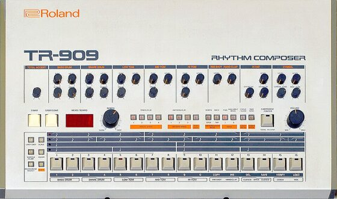

# DRUMKITS/TR-909

An emulation of the Roland TR-909 for [DrumSynth](../DrumSynth/README.md). The analog voices are synthesized; the hats,
crash and ride play the 909's own 6 bit ROM samples, as on the original.

| Instrument | Note | Instrument | Note |
|---|---|---|---|
| BD909 bass drum | 36 | CP909 hand clap | 39 |
| RS909 rim shot | 37 | CH909 closed hi-hat | 42 |
| SD909 snare drum | 38 | OH909 open hi-hat | 46 |
| LT909 low tom | 41 | CR909 crash | 49 |
| MT909 mid tom | 45 | RD909 ride | 51 |
| HT909 high tom | 48 | | |

The hats, crash and ride need the ROMs `909_HIGH`, `909_CRASH` and `909_RIDE`; without them these four are silent.
Download [eproms_9090.zip](http://www.synthdiy.com/files/2006/eproms_9090.zip) (`HiHats.bin`, `Crash.bin`, `Ride.bin`)
and send them with **LIBRARY → Extras → Drum ROMs → TR909**.

How close is it: the drums match a circuit simulation of the 909 within 1-4 dB per band and time window, the rim
shot is tuned to a recording, and the hats and cymbals are the real samples.

## How it was made

Sources: the recordings in <https://github.com/geikha/tidal-drum-machines>, folder `machines/RolandTR909`, and a
circuit-level simulation of the TR-909 voices at default settings, no accent.

Each instrument was built from the engine's parts (oscillators, noise, biquads, waveshaper, envelopes) using the
measured pitch curves, envelopes and spectra, then rendered and compared to the reference (1/3 octave spectra per
time window and the RMS envelope), and adjusted. Levels are set by the loudest 10 ms RMS, peaks stay below 0.9.

- BD909: fitted to the simulation. Sine at 52.6 Hz with the simulated pitch drop (262 Hz at 3 ms, τ about 13 ms),
  full level for 65 ms then a fast decay; a Chebyshev waveshaper adds the 909's harmonics, plus a 3 ms click.
- SD909: fitted to the simulation. Two tones (193 -> 172 Hz and 258 Hz) with their own envelopes and harmonics, the
  coupling products at 88 and 145 Hz, and noise peaking at 8 kHz that is gated after about 40 ms.
- LT909 / MT909 / HT909: fitted to the simulation. Each tom has three oscillators (LT about 85, 58 and 172 Hz; MT
  111, 72, 186 Hz; HT 142, 89, 240 Hz) with falling pitch, phase aligned so they beat like the original, plus a
  little noise.
- RS909: structure from the simulation (an impulse ringing two band passes into the 909's shaper), tuned to the
  recording `rim/rs01.wav`: tones at 224 and 494 Hz and a short third resonance near 975 Hz.
- CP909: fitted to the simulation. Five noise bursts (about 1 kHz) at 0.9, 11.7, 22.2, 32.7 and 40.5 ms and a
  darker tail to about 860 ms. A soft limiter in the burst part catches the rare noise peaks.
- CH909 / OH909: the hats ROM (`909_HIGH`, open hat first, closed hat after it), read at 30540 Hz with the 909's
  envelope, tilt and 307 Hz high pass. That rate was measured on the recordings; the simulation's clock was 5.35
  semitones too high.
- CR909 / RD909: the crash and ride ROMs read at about 34450 Hz, with the 909's decay at default settings. The ride's
  envelope is corrected to the recording `rd/Ride.wav`.

A version with noise-only hats and cymbals (no ROMs) was fitted too, but the kit here uses the ROMs.

## License and credits

- `hardware.jpg`: Photo: Brandon Daniel (derivative work: Clusternote), [CC BY-SA 2.0](https://creativecommons.org/licenses/by-sa/2.0), via [Wikimedia Commons](https://commons.wikimedia.org/wiki/File:Roland_TR-909_(large).jpg) (not part of the MIT license).
- The kit is played by [DrumSynth](../DrumSynth/README.md) (`lib/drumsynth`, © E.Heidt, MIT license, see [License](../../../README.md#license)).
