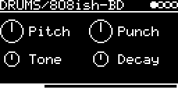

# DRUMS/808ish-BD

808-style bass drum: a resonant filter pinged by a short pulse, with a pitch kick at the start. It's the bass drum
of Mutable Instruments Peaks ([lib/peaks/drums/bass_drum.cc](../../../lib/peaks/drums/bass_drum.cc)) with its four
parameters on the four knobs.

## Parameters

| Knob | Range | Default | |
|---|---|---|---|
| **Pitch** | 33 Hz ... 73 Hz | 49 Hz (G1) | ±7 semitones |
| **Punch** | 0 ... 1 | 0.5 | pitch drop at the start of the hit |
| **Tone** | ~120 Hz ... open ... treble lift | ~3.8 kHz | lowpass after the resonator |
| **Decay** | short ... long | 0.5 | ring time |

Left encoder: Pitch, Tone. Right encoder: Punch, Decay.

Tone is fully open at about 0.81. Above that it starts boosting the highs (up to about +10 dB at the top), which
brings out the click.

## Usage

A trigger or MIDI note on the track's channel starts the drum. There's no V/OCT input, pitch comes from the knob
only. Mono output.

## How it works

The excitation is a positive pulse followed 1 ms later by a negative one
([excitation.h](../../../lib/peaks/drums/excitation.h)). It drives a Chamberlin state variable filter in band-pass
mode ([svf.h](../../../lib/peaks/drums/svf.h)), tuned 17 semitones higher for the first 4 ms. Punch feeds the
filter's own level back into its frequency and damping. A bit of the excitation is mixed in as click, then comes the
Tone lowpass.

Code 4.0 KB, RAM 240 bytes.

## License and credits

- `808ish-BD.cpp`: © 2021 E.Heidt, MIT license (see [License](../../../README.md#license)).
- [lib/peaks](../../../lib/peaks): Mutable Instruments Peaks, © Emilie Gillet, MIT license.
