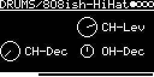

# DRUMS/808ish-HiHat

Closed and open 808-style hi-hats in one engine. The sound is the Peaks hi-hat
([lib/peaks/drums/high_hat.cc](../../../lib/peaks/drums/high_hat.cc)), six square waves through a band-pass and a
one-sided VCA. The decay envelopes are from Braids ([lib/braids/envelope.h](../../../lib/braids/envelope.h)),
because the Peaks one only has 4 steps.

## Parameters

| Knob | Range | Default | |
|---|---|---|---|
| **CH-Lev** | 0 ... 1 | 0.75 | closed hat level |
| **CH-Dec** | 71 ms ... 12 s | 71 ms | closed hat decay |
| **OH-Dec** | 71 ms ... 12 s | 1.6 s | open hat decay |

Left encoder: CH-Dec. Right encoder: CH-Lev, OH-Dec. (The top left slot is empty on purpose.)

## Inputs and outputs

| Input | Plays |
|---|---|
| TRIG-INPUT | closed hat |
| ACCENT-INPUT | open hat (trigger + accent at the same time: open hat only) |
| MIDI note, velocity > 100 | open hat |
| MIDI note, velocity <= 100 | closed hat |

Mono output.

The closed hat only partly chokes the open one: it pulls the open hat down by about 12 dB, then the open hat keeps
decaying at its normal rate. An open hat that is already far into its decay is cut off.

## How it works

Six squares at 414, 540, 607, 740, 800 and 1050 Hz are summed, band-passed around 8 kHz, half-wave rectified by the
"808-style VCA", high-passed and clipped. Both hats use the same frequencies but have their own oscillators,
filters and envelopes, and are added at the end.

Code 6.6 KB, RAM 520 bytes.

## License and credits

- `808ish-HiHat.cpp`: © 2021 E.Heidt, MIT license (see [License](../../../README.md#license)).
- [lib/braids](../../../lib/braids): Mutable Instruments Braids, © Emilie Gillet, MIT license.
- [lib/peaks](../../../lib/peaks): Mutable Instruments Peaks, © Emilie Gillet, MIT license.
