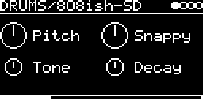

# DRUMS/808ish-SD

The snare drum model of Mutable Instruments Peaks
([lib/peaks/drums/snare_drum.cc](../../../lib/peaks/drums/snare_drum.cc)). Two resonant filters an octave apart
make the body, band-passed noise the snares, in the style of the 808.

## Parameters

| Knob | Range | Default | |
|---|---|---|---|
| **Pitch** | 110 Hz ... 247 Hz | 165 Hz (E3) | ±7 semitones, moves body and noise together |
| **Snappy** | 0 ... 1 | 0.5 | noise level, maxes out at 0.875 |
| **Tone** | 0 ... 1 | 0.5 | balance of the two bodies. 0 = equal, turning right favors the upper one |
| **Decay** | short ... long | 0.5 | ring time of the bodies and decay of the noise |

Left encoder: Pitch, Tone. Right encoder: Snappy, Decay.

The noise decay only has four steps (one per quarter of the Decay knob): about 21, 28, 43 and 85 ms.

## Usage

Trigger it from TRIG-INPUT or a MIDI note. No V/OCT input. Mono output.

## How it works

Each body is a band-pass state variable filter ([svf.h](../../../lib/peaks/drums/svf.h)) hit by short pulses in
the first millisecond, the second one an octave up with less resonance. The noise goes through a wide band-pass four
octaves above Pitch (2.6 kHz at the default) and has its own envelope. Everything is summed and clipped to 16 bit.

Code 5.8 KB, RAM 356 bytes.

## License and credits

- `808ish-SD.cpp`: © 2021 E.Heidt, MIT license (see [License](../../../README.md#license)).
- [lib/peaks](../../../lib/peaks): Mutable Instruments Peaks, © Emilie Gillet, MIT license.
