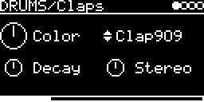

# DRUMS/Claps

Stereo hand claps from filtered noise: ten clap models plus seven random combinations of them. The claps are a
small drumkit in the [DRUMKITS/DrumSynth](../../DRUMKITS/DrumSynth/README.md) format
([lib/drumsynth/drumsynth_claps.h](../../../lib/drumsynth/drumsynth_claps.h), from `drumkits/Claps.json` of
[drumsynth](https://github.com/eh2k/drumsynth)) and are played by the same engine.

## Parameters

| Knob | Range | Default | |
|---|---|---|---|
| **Color** | 0.5 ... 1.5 | 1 | scales all filter frequencies. Noise only, so it's color rather than pitch |
| **Clap** | Clap909, Clap808, Clap002 ... Clap009, 6D17CEB4 ... 82087A1 | Clap909 | the clap model, takes effect on the next trigger |
| **Decay** | 0.1 ... 2 | 1 | stretches the tail; the burst timing stays the same |
| **Stereo** | 0 ... 1 | 0.5 | width. 0 is mono, 1 uses fully independent noise left and right |

Left encoder: Color, Decay. Right encoder: Clap, Stereo.

### Claps

| Clap | Name in the data | Parts |
|---|---|---|
| Clap909 | Clap909 | 3 |
| Clap808 | Clap808 | 2 |
| Clap002 | CP808_4_14 | 2 |
| Clap003 | CP80810_30 | 3 |
| Clap004 | CP808_2_18 | 2 |
| Clap005 | CP808_8_33 | 2 |
| Clap006 | CP808_5_42 | 3 |
| Clap007 | CP8VOpn_15 | 2 |
| Clap008 | CP808_6_42 | 2 |
| Clap009 | CPRND0 | 2 |
| 6D17CEB4, 73623629, 23CB4E73, 73C23C29, 42D1EC10, 5EFF9F17, 82087A1 | random, named by their seed | as the clap before |

Each part is white noise through one or two high-pass/band-pass filters (537 Hz ... 8 kHz) with its own envelopes.
Clap909, for example, has three short bursts 10 ms apart, a fourth at 33 ms, and a band-passed tail around 850 Hz.

The random claps use the seed to mix and match parts, envelopes and filters from the ten claps. They take their
number of parts from the clap selected before, so the same seed can sound different depending on what you had
selected earlier.

## Usage

A trigger (or a MIDI note on the track's channel) restarts the clap. No V/OCT input, stereo output.

## How it works

Two white noise sources are crossfaded into left and right by Stereo. Per part: amplitude envelope, two biquads in
series ([lib/misc/Biquad.cpp](../../../lib/misc/Biquad.cpp)), VCA envelope. The envelopes are breakpoint lists with
exponential segments. The parts are summed and go through a soft knee (tanh above 0.8), since some claps peak around
2.

If the heap is full the screen shows "OUT OF MEMORY" and the engine stays silent; a random clap that finds no memory
plays Clap909 instead.

Code 22 KB, RAM 952 bytes.

## License and credits

- `Claps.cpp`: © 2021 E.Heidt, MIT license (see [License](../../../README.md#license)).
- `../../../lib/drumsynth` by E.Heidt, MIT license.
- helpers in `../../../lib/misc`: Biquad by Nigel Redmon (EarLevel Engineering), biquad.hpp by KORG (BSD 3-Clause), others see the headers.
- [lib/plaits](../../../lib/plaits): Mutable Instruments Plaits, © Emilie Gillet, MIT license.
