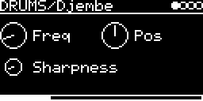

# DRUMS/Djembe

Physical model of a djembe: a short noise burst strikes a bank of 20 resonators. It's `pm.djembe` from the Faust
physical modeling library, compiled to C ([lib/faust/djembe.dsp](../../../lib/faust/djembe.dsp) ->
[lib/faust/djembe.dsp.h](../../../lib/faust/djembe.dsp.h)).

## Parameters

| Knob | Range | Default | |
|---|---|---|---|
| **Freq** | 0 ... 1000 Hz | 60 Hz | lowest mode; the others are spaced 200 Hz apart |
| **Pos** | 0 ... 1 | 0.5 | strike position. Higher is brighter |
| **Sharpness** | 0 ... 5 | 0.5 | length of the strike, 0 is a single sample |

Left encoder: Freq, Sharpness. Right encoder: Pos. Freq is linear, so the default sits near the left end.

All three are smoothed (~23 ms), the names and ranges come from the Faust program.

## Usage

A trigger (or MIDI note) strikes the drum. No V/OCT input, the pitch is only set by Freq. Mono output.

## How it works

The strike is white noise band-limited by Pos and shaped by a triangle envelope (Sharpness). It drives 20 two-pole
resonators in parallel; the lowest rings for 0.6 s, the highest for 30 ms, and higher modes are quieter.

The app adds a soft knee (tanh above 0.8) at the output, because fast repeated strikes pile up to about 2 and would
clip the DAC.

Code 5.5 KB, RAM 604 bytes.

## License and credits

- `Djembe.cpp`: © E.Heidt, MIT license (see [License](../../../README.md#license)).
- DSP generated by [Faust](https://faust.grame.fr) (`../../../lib/faust`); the Faust libraries it uses are by GRAME and Julius O. Smith III et al., LGPL with exception.
