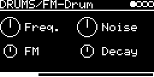

# DRUMS/FM-Drum

A sine drum with a fast falling pitch envelope: kicks, toms, zaps, and with some noise snare-like hits. This is the
FM drum of Mutable Instruments Peaks ([lib/peaks/drums/fm_drum.cc](../../../lib/peaks/drums/fm_drum.cc)) with an
added V/OCT input.

## Parameters

| Knob | Range | Default | |
|---|---|---|---|
| **Freq.** | 33 Hz ... 523 Hz at 0 V | 65 Hz (C2) | base pitch. The lowest third of the knob stays at 33 Hz |
| **Noise** | overdrive ... clean ... noise | clean (middle) | left of center adds overdrive, right of center mixes in white noise |
| **FM** | 0 ... 96 semitones | 48 semitones | depth of the pitch envelope, i.e. how far above Freq. the hit starts |
| **Decay** | 36 ms ... 2.2 s | 0.4 s | amplitude decay; the pitch envelope follows (6 ... 136 ms) |

Left encoder: Freq., FM. Right encoder: Noise, Decay.

## Usage

- TRIG-INPUT (or a MIDI note) starts the drum.
- V/OCT-INPUT is added to Freq., up to 2093 Hz. MIDI key 60 plays Freq. as set.
- Mono output.

## Notes

The V/OCT input is added before the knob is clamped, and two octaves are subtracted. That's why the bottom third of
Freq. does nothing at 0 V; with positive CV it comes back into play. The source marks this as a possible bug.

The oscillator also gets a bit of self-modulation (up to ±4 semitones) and, on low notes, an extra 16-semitone pitch
blip for the first 20 ms.

Code 8.5 KB, RAM 224 bytes.

## License and credits

- `FM-Drum.cpp`: © 2021 E.Heidt, MIT license (see [License](../../../README.md#license)).
- [lib/peaks](../../../lib/peaks): Mutable Instruments Peaks, © Emilie Gillet, MIT license.
