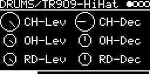

# DRUMS/TR909-HiHat

Hi-hats and ride of the Roland TR-909, played from its cymbal ROMs. Closed hat, open hat and ride each have their
own trigger, MIDI keys, level, decay and pan.

## Parameters

| Knob | Range | Default | |
|---|---|---|---|
| **CH-Lev** | 0 ... 1 | 1 | closed hat level |
| **CH-Dec** | 0 ... 1 | 0.2 (38 ms) | closed hat fade, 12 ... 140 ms; 1 = no fade |
| **OH-Lev** | 0 ... 1 | 1 | open hat level |
| **OH-Dec** | 0 ... 1 | 0.5 (204 ms) | open hat fade, 12 ... 396 ms; 1 = full sample (0.77 s) |
| **RD-Lev** | 0 ... 1 | 1 | ride level |
| **RD-Dec** | 0 ... 1 | 0.5 (268 ms) | ride fade, 12 ... 524 ms; 1 = full sample (1.02 s) |

Left encoder: CH-Lev, OH-Lev, RD-Lev. Right encoder: CH-Dec, OH-Dec, RD-Dec.

Level and decay are read on each hit, so changes are heard from the next hit on.

## Inputs and outputs

The I/O page has three trigger inputs, **TRIG-INPUT(CH)**, **TRIG-INPUT(OH)** and **TRIG-INPUT(RD)**. MIDI keys on
the track's channel:

| Instrument | MIDI keys |
|---|---|
| CH | 42, 44 (pedal) |
| OH | 46 |
| RD | 51, 53 (bell), 59 (edge) |

V/OCT-INPUT transposes all three (0 V = original pitch); there is no pitch knob. MIDI pitch bend works, velocity
does not.

Stereo output. For each instrument with a trigger source the I/O page has its own PAN and LEVEL.

The closed hat chokes the open hat. If both are hit at the same time, the open hat wins. The ride is independent.

## ROMs

Needs the flash blobs `909_HIGH` and `909_RIDE` (at least 32768 bytes each).
Download [eproms_9090.zip](http://www.synthdiy.com/files/2006/eproms_9090.zip)
(`HiHats.bin`, `Ride.bin`) and send them with **LIBRARY → Extras → Drum ROMs → TR909**.
Without them the screen shows `ROMS NOT FOUND`.

`909_HIGH` holds the open hat (first 24 KB) and the closed hat (last 8 KB). The samples are unsigned 8-bit at 32 kHz,
played with Hermite interpolation. `DRUMS/TR-09` uses the same ROMs for its hats and cymbals.

Code 2.7 KB, RAM 264 bytes.

## License and credits

- `TR909-HiHat.cpp`: © E.Heidt, MIT license (see [License](../../../README.md#license)).
- Sample data: the ROMs of the Roland TR-909 ([eproms_9090.zip](http://www.synthdiy.com/files/2006/eproms_9090.zip), the EPROMs of Trevor Page's 9090).
