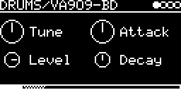
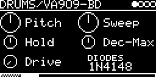

# VA-909

The Roland TR-909 with its voices modelled from the circuit ([lib/va909](../../../lib/va909/README.md),
[MODEL.md](../../../lib/va909/MODEL.md)): the 909's knobs and its accent as the circuit makes them. One app
(`DRUMS/VA-909.bin`), five engines in the menu's group **DRUMS**, after DRUMS/Claps:

- **DRUMS/VA909-BD**, **VA909-SD**, **VA909-RS**, **VA909-CP**, **VA909-Toms**: one instrument each, on a track of
  its own; VA909-Toms plays the tom its knob **Tom** picks, LT, MT or HT.

Each has the 909's knobs and **mods**: parts of the circuit changed as a pot in their place would. VA909-BD has its mods
on page 2; VA909-SD and VA909-Toms have one page, their two mods in the row between the 909's knobs; RS and CP, which
have no knobs on the 909 but LEVEL, their mods and Level / Accent on one page. DRUMS/TR909-HiHat follows the toms on the
engine page: it plays the 909's hi-hats and ride from its ROMs. The kit
[DRUMKITS/TR-909](../../DRUMKITS/TR-909/README.md) plays the 909's samples.

 

The hats, the cymbals and a kit of all eleven instruments are in the source but off for now: see
[Off for now](#off-for-now).

## The engines

| Engine | Instruments | Triggers | Out | Page 1 | Page 2 |
|---|---|---|---|---|---|
| DRUMS/VA909-BD | BD | TRIG-INPUT | mono | Tune, Attack, Level, Decay | Pitch, Sweep, Hold, Dec-Max, Drive, Diodes |
| DRUMS/VA909-SD | SD | TRIG-INPUT | mono | Tune, Snappy, Decay, Color, Level, Tone | |
| DRUMS/VA909-RS | RS | TRIG-INPUT | mono | Tune, Ring, Level, Decay | |
| DRUMS/VA909-CP | CP | TRIG-INPUT | mono | Color, Rate, Length, Tail, Level | |
| DRUMS/VA909-Toms | LT MT HT (Tom) | TRIG-INPUT | mono | Tune, Tom, Bend, Noise, Level, Decay | |

Screenshots: [BD](VA-909.png) ([2](pages/BD_page2.png)), [SD](pages/SD.png),
[RS](pages/RS.png), [CP](pages/CP.png), [Toms](pages/Toms.png).

The engines of the app share one copy of its code (the DSM copies it into its SRAM once); each allocates only its own
voices.

## Triggers

- **DRUMS/VA909-BD, SD, RS, CP, Toms**: the track's TRIG-INPUT (any note on its MIDI channel), a normal hit each.
- **Tom** (VA909-Toms): the tom of the next hit, LT, MT or HT. The three are voices of their own, as on the 909: a tom
  rings on while another one is hit, so Tom modulated (a CV, an LFO, a sequencer's output) plays a fill from one track.
- The **ACCENT** input (I/O page) high at a hit, or a MIDI note over velocity 100, accents the instruments hit with it,
  as the 909's accent track accents its step: by the Accent knob while the ACCENT input is patched, else by 0.8.

## The 909's knobs

Laid out as the released drums have their knobs (DRUMS/808ish-BD, DRUMS/909ish-BD: Pitch | Punch, Tone | Decay; a row
per instrument as in DRUMS/TR909-HiHat): the tune at the top left, the decay at the bottom right and the attack or
snappy above it (the right encoder turns them), Accent / Level at the bottom of the left column. SD's Tone is the
snappy's length: the decay's place, its mods Decay and Color in the row between (the left column the tones, the right
one the snappy); CP's Color the place of the pitch, as on DRUMS/Claps; the toms' Tom the attack's place, their mods Bend
and Noise in the row between.

**Level** (each engine): **Accent** while the ACCENT input is patched: the 909's TOTAL ACCENT, how far an accented hit
raises the voices' ACCENT line towards the DAC's top. **Level** without it: the engine's level, its square (0.8 is the
recordings' level, 1 is +3.9 dB, 0.4 -12 dB); with the ACCENT input patched the level stays at 0.8's. The track's LEVEL
(I/O page) is there either way.

- **BD**: Tune is the pitch envelope's decay (8 ... 29 ms), not the pitch (49 Hz at rest), as on the 909; Attack the
  click's level, Decay the level's decay after the hold of some 70 ms. An accent is louder (up to +4.4 dB), its click
  as much stronger, its decay a little longer; the pitch sweep stays.
- **SD**: Tune both tones (the lower 119 ... 228 Hz on the 909's TUNE, the upper 1.44 times it), Tone the snappy's
  length, Snappy its level. **Tune** has the 909's TUNE in its middle half (0.25 ... 0.75); below and above it R287 (+15
  V to TUNE's top) x2 ... x0.5 at TUNE's ends: the lower tone 69 Hz at 0, 382 Hz at 1.
- **RS**: three bridged-T resonators (219, 495, 1052 Hz) rung by the trigger's edge, clipped by two diodes; the
  909's LEVEL at 8. No knob on the 909 but LEVEL: VA909-RS has its mods and Level on its page.
- **CP**: the 909's LEVEL at 3 of 10 (at 5.5 it peaked at 1.27 before the output's limit, 2.17 accented). VA909-CP
  has its mods and Level on its page, as RS.
- **LT, MT, HT**: Tune the three VCOs of the tom together (TUNE doubles them: the low tom's some 63/41/112 Hz at 0,
  122/82/220 Hz at 10), each bent up some 2 semitones at the hit; Decay the main tone's decay. One Tune and one Decay
  for the three toms, each in its own range (as the 909's knobs at the same place). **Decay**: the 909's DECAY in the
  lower half, its top in the middle (the default: the 909's longest, to -40 dB LT some 0.6 s, HT 0.4 s), above it
  longer: C21 (ENV2's capacitor) up to x4, the tom up to some 2.6 times as long (LT 1.55 s, HT 1.05 s). Turning VR11
  further would hardly do: at DECAY's top C21 empties mostly through R100 into C23. The 909's tom noise (a short
  burst at each hit) with them. Their level is the 909's LEVEL at 7 of 10: about as loud at every Tune, an accent
  +4 dB.
- The output is the 909's mix out (the five mono, as a channel of the 909's mix at LEVEL 128 and PAN in the middle),
  VA909-BD 6 dB louder: as loud as the other engines' bass drums, LUFS -15.0 against DRUMS/909ish-BD -14.1, MD/TRX-BD
  -15.2, CY/KICK -15.7, its click then at the soft limit; VA909-SD 9 dB louder, LUFS -15.8 against DRUMS/909ish-SD
  -15.2, MD/TRX-SD -17.1, its peak 0.85; VA909-RS 3 dB louder, LUFS -19.4 against MD/EFM-RS -21.9, MD/P-I-RS -16.6,
  MD/TRX-RS -27.9, its peak 0.78; VA909-CP 4.5 dB louder, LUFS -17.8 against MD/TRX-CP -20.0, MD/EFM-CP -16.1, its peak
  0.95, accented at the soft limit; VA909-Toms 6 dB louder, LUFS -17.5 (LT; MT -18.0, HT -17.2) against MD/EFM-XT -17.9,
  MD/TRX-XT -13.0, its peak 0.54, accented 0.75. Its high pass at 123 Hz (C154) and its inversion, then a soft limit (1
  at 1.5). Peaks before it with a hit every 250 ms: 0.3 ... 0.7 without accent, up to 1.05 (BD) with Accent 0.8.

## Mods

BD's page 2; SD and the toms: the row between the 909's knobs; RS and CP: their only page, with Level. Knobs (the left
encoder turns the left column, the right one the right). Each is a part of the circuit, its fitted value times a factor;
at **0.5** (BD's Drive: **0**) the part is as fitted and the voice plays the samples it plays without the mod. Nothing
here is fitted to a modded 909: the ranges are chosen, the circuit makes the rest (a part often does more than its name:
R26 sets the sweep's depth and its decay). Most of them can clip at their ends with Level or Accent up.

| Engine | Mod | The part | 0 ... 1 |
|---|---|---|---|
| BD | Pitch | R27 (+15 V into IC12a): the VCO's rest | the pitch at rest one octave down ... up (24.6, 49.3, 98.5 Hz) |
| BD | Sweep | R26 (ENV3 into IC12a) | the sweep's depth x0.5 ... x2 (deeper is shorter: R26 discharges C9) |
| BD | Hold | C7, the hold | the hold before the decay (some 70 ms) x0.35 ... x2.8 |
| BD | Dec-Max | VR5 DECAY | Decay's range x0.25 ... x4 |
| BD | Drive | a gain before R52: the triangle into D10/D11 | x1 (0, the 909) ... x16: the shaper's sine towards a square |
| BD | Diodes | D10/D11: Ge, 1N4148 (the 909), 2x1N4148, LED | the triangle rounded from some 0.25, 0.5, 0.9 V; through LEDs almost as it is. The body's level kept |
| SD | (Tune below 0.25, above 0.75) | R287 (+15 V to TUNE's top) | x2 at 0 ... x1 ... x0.5 at 1: the 909's TUNE range down, up |
| SD | Decay | C83, C82 (ENV3, ENV2: the tones' VCAs) | the tones' decay x0.35 ... x2.8 |
| SD | Color | C81, C84 (IC40a's low pass on the snappy's noise, its Q kept) and C80 (the high pass after it into Q48) together | the noise's band: low pass 3.8 kHz ... 15.2 kHz (fitted) ... 20 kHz, high pass 540 Hz (more body) ... 1.5 kHz ... 4.3 kHz |
| RS | Tune | C113 ... C118 (the three bridged Ts) | their frequencies together one octave down ... up |
| RS | Ring | R407/R414/R416 up, R394/R411/R404 down by the same factor | the Ts' Q x0.35 ... x2.8, their frequencies kept |
| RS | Decay | C119 (ENV, Q65's base) | the decay x0.35 ... x2.8 |
| CP | Color | C42, C43 (IC26b's band pass on the noise) | one octave down ... up |
| CP | Rate | C65 (the bursts' sawtooth) | their rate x0.5 ... x2 |
| CP | Length | C62 | how long the bursts go on x0.35 ... x2.8 |
| CP | Tail | C59, C61 (ENV2, Q37's base) | the reverb tail x0.35 ... x2.8 |
| Toms | Bend | C24 (Q18's base) | how long the bend at the hit lasts x0.25 ... x4 |
| Toms | Noise | R114 (the tom noise into Q21's collector) | none ... x4 (+12 dB) |
| Toms | (Decay above 0.5) | C21 (ENV2's capacitor, each tom) | x1 ... x4 at Decay 0.5 ... 1; below 0.5 the 909's DECAY |

A mod's change computes the voice's coefficients again (not its tables): turned by hand that is nothing; modulated, so
that it changes in every frame, it costs some 0.6k (BD), 1.2k (SD: Decay, Color, Tune in its outer quarters), 0.7k (RS,
CP), 2.3k (Toms: Bend, Noise, Decay above the middle) instructions a frame more.

**Drive** is the one mod of a table: the 909's Drive mods (Pitch, Drive and Tune Depth added to the bass drum, the
Tune and Decay ranges extended; [MATRIXSYNTH](https://www.matrixsynth.com/2005/11/tr-909-mod-page.html): "waveform
adjust from normal to square, for hard clipped sounds") act where the triangle meets the diodes D10/D11 that round it
into the bass drum's sine; here a gain before R52 (no part values of those mods are known). The shaper's table is
filled again towards a new Drive, 4 of its 64 pairs of points a frame (the shaper is odd; some 25k instructions more for
8 ms, with other Diodes 27k for 12 ms: first the 1N4148's level at the new Drive; modulated, as long as it moves). Up,
the body gets louder (LUFS +3.5 dB at 0.5, +5.5 dB at 1) and its third harmonic rises from -22 dB to -5 dB; through the
mix out's high pass at 123 Hz (above the 49 Hz body) the square's edges come out as peaks (the crest factor of the body
2.8 at 0, 5.4 at 1).

**Diodes** is the other mod there: D10/D11 swapped. The e-licktronic forum's addition to the 909's Bass Drum
Overdrive mod puts red LEDs there, on a switch; germanium diodes and two 1N4148 in series each way are swaps as in a
distortion pedal's clipper, no 909 mod known for them. The diodes typical, not measured: germanium 0.25 V at 100 uA
with a soft knee (Is 1.6e-7 A, N 1.5), two 1N4148 the fitted ones with twice their N, red LEDs 1.5 V at 10 uA, 1.9 V at
20 mA (Is 4e-18 A, N 2). They change the wave, not the level: the body (Q12's current, not the click) is kept as loud
as with the 1N4148 at the same Drive (LUFS within 0.8 dB; the circuit itself: germanium -4 dB, two 1N4148 +3 ... +7
dB, LEDs +3 ... +11 dB, which ran into the output's limit). The level is measured while the shaper's table is filled
again and follows it point by point: switched during a hit, the body at most 0.4 dB over the louder of both and its
peak x1.16 (the voice natively, Drive up to 0.5). The body 30 ... 200 ms after a hit (QEMU, Tune 0.88, Decay 0.68),
Drive 0 unless named:

- **Ge**: the tops flatter, the third harmonic -13 dB (the 1N4148 -23 dB); with Drive sooner a square (the fifth
  harmonic -17 dB at 0.25, the 1N4148 -22 dB).
- **2x1N4148**: the triangle less rounded (third harmonic -15 dB); with Drive a sine again, at 0.25 its third harmonic
  -28 dB (a null there: it changes sign from the triangle's to the square's).
- **LED**: the LEDs hardly conduct, the triangle passes the divider R52 / R53 as it is (third harmonic -14 dB). Q12's
  collector gets three times the 1N4148's few mV: its gain, bf one way and br the other (SatVca), makes the body
  lopsided, the second harmonic -9 dB at Drive 0.25 (the 1N4148 -19 dB), at the voice's output the one half up to
  three times the other (the 1N4148: 1.3 times). That is the circuit as modelled, not a modded 909 measured; two
  1N4148 do it less (-13 dB).

## How close

Against recordings of a TR-909 with known knobs (the Rob Roy Recordings, 1995), a 1/3-octave band measure
(lib/va909/MODEL.md), the knobs as the recordings were made and the mods at their middle:

| | this | the kit DRUMKITS/TR-909 |
|---|---|---|
| bass drum, 24 hits | 2.24 dB, pitch 16 cents | 5.94 dB, 318 cents |
| snare drum, 52 hits | 3.48 dB, tones 19 cents | 7.38 dB, 191 cents |
| hand clap, 2 hits | 4.17 dB | 6.42 dB |
| hi-hat, 12 hits | 2.37 dB | 6.00 dB |
| crash, 6 hits | 1.79 dB | 5.21 dB |
| ride, 5 hits | 2.01 dB | 6.28 dB |
| toms, 48 hits | 3.81 dB, tones 50 cents | 7.75 dB |
| rim shot, 1 hit | 3.60 dB | 6.94 dB |

The fits ended at 2.27, 3.48, 4.16, 3.83 and 3.59 dB (BD, SD, CP, toms, RS); the numbers above are the code as it is,
not refitted: the toms leave out what they no longer hear (2026-11-13), the VCAs' base current follows its collector
with the sign Ebers-Moll gives (checked against ngspice, `lib/va909/fit/vcabase.py` on the branch va909; it had the
other sign before 2026-11-13), the toms' attack (Q18) follows Ebers-Moll's law instead of a switch and the snare's
tones start as in SPICE (2026-11-14, `fit/ttq18.py`, `fit/sd_onset.py`: the toms 3.806 -> 3.811 dB, the snare 3.50
-> 3.48 dB).

## Cost

In QEMU (instructions in a frame of 24 samples; a kit's instruments in turn), with a hit every 250 ms and every 20 ms
(2026-11-14; the toms: LT, its Decay in the middle; three ringing at once, Tom modulated, up to some 31.6k, measured
before Q18's table of 2026-11-14):

| Engine | 250 ms: average, at most | 20 ms: average, at most | RAM |
|---|---|---|---|
| DRUMS/VA909-BD | 5.5k, 9.0k | 8.3k, 9.0k | 7.2 KB |
| DRUMS/VA909-SD | 10.9k, 11.7k | 10.5k, 11.7k | 7.1 KB |
| DRUMS/VA909-RS | 7.7k, 10.5k | 9.1k, 10.5k | 5.5 KB |
| DRUMS/VA909-CP | 5.9k, 6.4k | 6.1k, 6.4k | 5.2 KB |
| DRUMS/VA909-Toms | 9.1k, 11.4k | 11.4k, 11.6k | 11.7 KB |

On the DSM (cycles in a frame, 240k the whole frame; the engine on track 4 hit over MIDI, SYNTH/Plaits with two
inserts and VA909-BD on the other tracks; 2026-11-13, before Q18's table and the snare's Newton steps at its onset of
2026-11-14): the app (63 KB) runs from the D2 SRAM next to SYNTH/Plaits (184 KB). With the
hats', the cymbals' and the kit's code in it (79 KB, `VA909_ALL 1`) it did not fit there and ran from the QSPI flash,
at 2.3 to 2.8 times the cycles (the last column). Idle is mostly the firmware's part of a track (SEQ/EuclidArp: 4.0k).
A tom leaves out what it no longer hears: VCO-3's VCA and the tom noise after some 0.12 s (the low tom; 40 dB under the hit, -46 dB
under the tom; it was 60 dB, 0.25 s), Q18's bend once it moves VCO-1 by less than 0.1 mV (after some 100 ms): 21.6k ->
16.6k at a hit every 250 ms; hit every 20 ms the whole model runs all the time, as before.

| Engine | idle | 250 ms | 20 ms | 250 ms from the flash |
|---|---|---|---|---|
| DRUMS/VA909-BD | 3.9k | 11.7k | 18.0k | 33.0k |
| DRUMS/VA909-SD | 4.1k | 21.9k | 21.4k | 57.3k |
| DRUMS/VA909-RS | 3.8k | 16.2k | 19.5k | 38.0k |
| DRUMS/VA909-CP | 3.9k | 13.5k | 14.0k | 34.3k |
| DRUMS/VA909-Toms | 4.3k | 16.6k | 23.4k; LT MT HT in turn 53.9k | 56.9k; 93.1k |

It needs a firmware with 8b3c691c (`engine::hasAccent()`); an older one does not start it. The engine page lists the
five after DRUMS/Claps and before DRUMS/TR909-HiHat with a firmware that has them in its `engines_order`
(`machine/src/ui.cpp`); an older one lists them by name, after DRUMS/TR909-HiHat.

## Off for now

`VA909_ALL 1` (`VA-909.cpp`) brings back three more engines, left out for now (DRUMS/TR909-HiHat plays the hats and
the ride); without it their code is not compiled (the app 63 KB instead of 79 KB):

| Engine | Instruments | Triggers | Out | Page 1 | Page 2 |
|---|---|---|---|---|---|
| DRUMS/VA909-Hats | CH OH | own TRIGs | stereo | CH-Dec, OH-Dec, Level | Tune, Acc-Amt |
| DRUMS/VA909-Cymbals | CR RD | own TRIGs | stereo | CR-Tune, RD-Tune, Level | CR-Dec, RD-Dec, Acc-Amt |
| DRUMS/VA909-Kit | BD SD LT MT HT RS CP CH OH CR RD | own TRIGs | stereo | BD \| SD; then the toms, the hats and cymbals | (page 3) |

- The hats and the cymbals play the 909's ROMs: the flash blobs `909_HIGH`, `909_CRASH` and `909_RIDE` (the web app
  uploads them). Without them they are silent and the module says so.
- **DRUMS/VA909-Kit** (DRUMS/VA-909 before, its patches load): all eleven on one track, each with its own TRIG and its
  General MIDI keys (BD 35, 36; SD 38, 40; RS 37; CP 39; CH 42, 44; OH 46; CR 49, 55, 57; RD 51, 53, 59; LT 41, 43; MT
  45, 47; HT 48, 50), the 909's knobs and no mods, three pages and the mix page: page 1 BD | SD, an instrument a column
  (BD-Tune, BD-Att, BD-Dec; SD-Tune, SD-Snap, SD-Tone), page 2 the toms, a tom a row, page 3 CH-Dec OH-Dec, CR-Tune
  RD-Tune and Level.
- **CH, OH**: CH-Dec and OH-Dec the hat's decays (closed some 10 ... 50 ms, open 78 ... 200 ms time constant). CH
  and OH are one voice as on the 909: a closed hat cuts an open one. MIDI CC 4 turns OH-Dec down (127: to 0).
- **CR, RD**: Tune the ROM's clock: 27.6 ... 55.8 kHz (the crash), 26.7 ... 55.5 kHz (the ride); the cymbal's
  length goes with it (1.2 ... 0.6 s).
- The hat's and the cymbals' accent is the circuit's exponential converter, at 0.3 of the drums' accent voltage: the
  hat +5 dB, the cymbals +8 dB at Accent 0.8 (+6 / +10 dB at 1). With the drums' whole voltage they were
  +16 ... 22 dB and clipped hard (no recording says what the 909's ROM voices get). A MIDI note in a kit plays a
  softer hit by its velocity (velocity 64: the hat 3.4 dB, the cymbals 5.4 dB softer). Peaks with a hit every 250 ms
  up to 1.25 (the cymbals as they pile up) with Accent 0.8.
- Their mods (the Cymbals' decays as fitted at **1**; modulated, the cymbals' cost 2.2k instructions a frame more):

| Engine | Mod | The part | 0 ... 1 |
|---|---|---|---|
| Hats | Tune | the ROM's clock (IC72c/d: R493, R492, C160), fixed on the 909 | 22.3 ... 31.6 (fitted) ... 44.6 kHz, as the cymbals' TUNE: the length with it |
| Hats, Cymbals | Acc-Amt | the share of the ACCENT line's excursion the ROM voices get | 0 ... 0.3 (the kit's, a guess) ... 0.6; above 0.3 accents clip soon |
| Cymbals | CR-Dec, RD-Dec | the envelope over the ROM's address (the model's, not a part) | it ends at 0.2 ... 1 of the address (1: as fitted, the ROM's length) |

| Engine | 250 ms: average, at most | 20 ms: average, at most | RAM |
|---|---|---|---|
| DRUMS/VA909-Hats | 4.9k, 4.9k | 4.9k, 4.9k | 5.2 KB |
| DRUMS/VA909-Cymbals | 8.3k, 8.6k | 8.4k, 8.6k | 7.2 KB |
| DRUMS/VA909-Kit | 13.7k, 29.6k | 68.1k, 73.3k | 23.9 KB |

## License

`VA-909.cpp` and [lib/va909](../../../lib/va909): (c) 2026 E. Heidt, Mozilla Public License 2.0
([LICENSE](../../../lib/va909/LICENSE), see [License](../../../README.md#license)): usable in other software, also
closed one; whoever distributes changed versions of these files publishes their source under the MPL as well.
