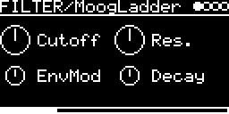

# FILTER/MoogLadder

Moog-style 4-pole ladder lowpass with a decay envelope on the cutoff. The model is D'Angelo and Välimäki's
"An Improved Virtual Analog Model of the Moog Ladder Filter" (ICASSP 2013), taken from the
[MoogLadders](https://github.com/ddiakopoulos/MoogLadders) collection and run 2x oversampled. Stereo: L and R go
through two ladders with the same settings.

## Parameters

| Knob | Range | Default | |
|---|---|---|---|
| **Cutoff** | 33 Hz ... 20 kHz | 1.05 kHz | base cutoff, 10 octaves over the knob (20 kHz is reached at 0.93) |
| **Res.** | 0 ... 1 | 0.5 | resonance |
| **EnvMod** | 0 ... 1 | 0.5 | how far a trigger opens the filter, up to 10 octaves |
| **Decay** | 4.7 ms ... 1.3 s | 80 ms | envelope decay |

Left encoder: Cutoff, EnvMod. Right encoder: Res., Decay.

## Usage

Put it on a track and choose its input on the I/O page: other tracks with **#&lt;track&gt; &lt;engine&gt;** (set their
AUDIO-OUT to `-` to hear only the filter), or **AUX-INPUT** (jack or `USB`) with **AUX-LEVEL** as the level.

- TRIG-INPUT or a MIDI note restarts the envelope.
- V/OCT-INPUT moves the cutoff 1 octave per volt (through the quantizer). MIDI notes relative to C4, pitch bend
  and transpose also move it, so the filter can track a melody.

Each input is doubled before the ladder, so a mono source (a single jack or the INSERT of a mono engine feeds both
inputs) is driven as hard as in the old mono version, which added L and R. The passband gets quieter as resonance goes up.

## Implementation

Four nonlinear stages with tanh saturation (a cheap rational approximation) and trapezoidal integration, running at
96 kHz with simple linear-interpolation up- and downsampling. The model is
[ImprovedModel.h](../../../lib/MoogLadders/src/ImprovedModel.h) rewritten in `MoogLadder.cpp` in float instead of
double, for both channels in one loop: the tanh of L and R share one division (the division is the slow part on the
Cortex-M7). The float version sounds like the double one (88 ... 109 dB SNR, with self-oscillating resonance only a
slow phase drift of the oscillation). The envelope is Plaits' decay envelope, updated every 0.5 ms.

Code 5.4 KB, RAM 264 bytes.

## License and credits

- `MoogLadder.cpp`: © 2025 E.Heidt, MIT license (see [License](../../../README.md#license)).
- [MoogLadders](https://github.com/ddiakopoulos/MoogLadders) by Dimitri Diakopoulos and the authors of the ladder models in it, see [LICENSE](../../../lib/MoogLadders/LICENSE) (public domain).
- [lib/plaits](../../../lib/plaits): Mutable Instruments Plaits, © Emilie Gillet, MIT license.
