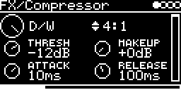

# FX/Compressor



Stereo-linked feed-forward compressor with a soft knee. Works as bus glue, as a limiter (LIMIT), or for parallel
compression with D/W.

```
input -> level = max(|L|, |R|) -> curve (Thresh, Ratio, knee) -> Attack / Release -> gain + Makeup -> D/W -> output
```

## Parameters

| Knob | Range | Default | |
|---|---|---|---|
| **D/W** | dry ... wet | wet | parallel compression. No latency, so no comb filtering |
| **Ratio** | 1.5:1 ... 20:1, LIMIT | 4:1 | LIMIT is ∞:1 |
| **Thresh** | -40 dB ... 0 dB | -12 dB | peak level where reduction starts |
| **Makeup** | 0 ... +24 dB | 0 dB | gain after compression |
| **Attack** | 0.1 ms ... 100 ms | 10 ms | time constant |
| **Release** | 10 ms ... 2 s | 100 ms | time constant |

Left encoder: D/W, Thresh, Attack. Right encoder: Ratio, Makeup, Release.

The bar at the right edge of the screen is the gain reduction meter, 24 dB over its height, showing the peak
reduction since the last redraw.

## Usage

Pick the source on the I/O page: **#&lt;track&gt; &lt;engine&gt;** pulls in other tracks (put their AUDIO-OUT on `-` if
only the compressed signal should be heard), **AUX-INPUT** takes a jack or `USB`, at the level set by **AUX-LEVEL**.

Both channels get the same gain from the louder one, so the stereo image stays put. There is no lookahead: a
sudden transient passes at the old gain until the attack catches up, and with a lot of Makeup that can clip. A
shorter Attack or less Makeup helps.

## Implementation

Log-domain design from Giannoulis, Massberg and Reiss, "Digital Dynamic Range Compressor Design - A Tutorial and
Analysis" (JAES 2012): peak detector, static curve with a 6 dB knee, one-pole smoothing of the reduction with
separate attack and release. log2/exp2 are cheap polynomials, no libm per sample. Below the knee with Makeup at
0 the input passes bit for bit.

CPU on the DSM about 2.6 %. Code 3.1 KB, RAM 264 bytes.

## License and credits

- `Compressor.cpp`: AI generated (Claude Opus 5.5), prompted and reviewed by E.Heidt; no copyright claimed, MIT license (see [License](../../../README.md#license)).
