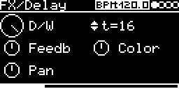

# FX/Delay



Stereo ping-pong delay, up to 1 s per side. Time is set in steps that follow the module clock when it runs. The
input always passes at full level; D/W only sets the echo level.

```
line L <- Feedb * (echo R + 2 * Pan       * Color(in L))      out L = in L + D/W * echo L
line R <- Feedb * (echo L + 2 * (1 - Pan) * Color(in R))      out R = in R + D/W * echo R
```

## Parameters

| Knob | Range | Default | |
|---|---|---|---|
| **D/W** | 0 ... 1 | 1 | echo level |
| **Time** | 1 ... 128 steps | 16 | delay time, see below |
| **Feedb** | 0 ... 1 | 0.5 | feedback, also the input gain into the lines. 0 = no echo, 1 = no fade |
| **Color** | 0 ... 1 | 0.5 (flat) | below 0.5 lowpass (down to 200 Hz), above 0.5 highpass (up to 2 kHz) |
| **Pan** | 0 ... 1 | 0.5 | input feed: 0 = right input into right line only, 1 = left into left only |

Left encoder: D/W, Feedb, Pan. Right encoder: Time, Color.

Time steps:

| Clock | One step | Examples |
|---|---|---|
| running | 1/32 beat | 8 = 1/16, 16 = 1/8, 24 = dotted 1/8, 32 = 1/4. Capped at 1 s (shown as `t=<n> 1s`) |
| off | 7.8 ms | 16 = 125 ms, 64 = 500 ms, 128 = 1 s |

## Usage

Audio comes in from the I/O page: **AUX-INPUT** (jack or `USB`, scaled by **AUX-LEVEL**) or other tracks via
**#&lt;track&gt; &lt;engine&gt;**.

There is no clock input of its own; it uses the module tempo from CLOCK-Source on the CLOCK+TIMING+MIDI page (`INT`,
`T1` or `MIDI`). With `-` the steps are fixed at 7.8 ms and the label shows milliseconds. While a clock runs the
header shows the BPM.

Color filters only the input on its way into the lines (6 dB/oct), the repeats aren't filtered again. Small time
changes glide over about 50 ms and bend the pitch of the echoes; changes over 0.1 s jump.

Two 1 s lines stored as 16 bit ([stmlib DelayLine](../../../lib/stmlib/dsp/delay_line.h)). Code 3.3 KB, RAM 192 KB.

## License and credits

- `Delay.cpp`: © 2021 E.Heidt, MIT license (see [License](../../../README.md#license)).
