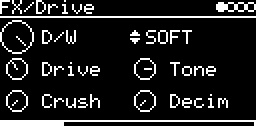

# FX/Drive



Saturation, wave folder and bit crusher in one stereo insert effect.

```
input -> Drive -> curve (2x oversampled) -> Crush -> Decim -> Tone -> DC blocker -> D/W -> output
                                                                           input ----^
```

## Parameters

| Knob | Range | Default | |
|---|---|---|---|
| **D/W** | dry ... wet | wet | dry/wet mix. The dry signal is delayed by the same amount as the wet one, so mixing doesn't comb filter |
| **Mode** | SOFT, TUBE, HARD, FOLD | SOFT | the curve, see below |
| **Drive** | -12 dB ... +40 dB (FOLD: +24 dB) | +6 dB | input gain. Below 0 dB the level is made up again, so the far left is almost clean |
| **Tone** | 200 Hz ... 23.5 kHz | 9 kHz | 2-pole lowpass after the curve, no resonance |
| **Crush** | 16 bit ... 1 bit | off | bit depth |
| **Decim** | 48 kHz ... 375 Hz | off | sample rate reduction (sample & hold), aliasing included |

Left encoder: D/W, Drive, Crush. Right encoder: Mode, Tone, Decim.

### Modes

| Mode | Curve | Sound |
|---|---|---|
| **SOFT** | x / sqrt(1 + x²) | smooth saturation, odd harmonics |
| **TUBE** | SOFT for x ≥ 0, x / sqrt(1 + 4x²) for x < 0 | asymmetric, adds even harmonics. Most noticeable at medium Drive, at full Drive it gets close to HARD |
| **HARD** | clamp(x, -1, 1) | hard clipping, brightest |
| **FOLD** | sin(x) | wave folder, about 5 folds at full Drive |

All curves are linear around zero and limit at 0.75, which leaves some headroom.

## Usage

Set the input on the I/O page: **#&lt;track&gt; &lt;engine&gt;** for other tracks (set their AUDIO-OUT to `-` if you
only want to hear the effect), or **AUX-INPUT** for a jack or `USB`, with **AUX-LEVEL** as the level.

The output gets louder with more Drive; use the track LEVEL to compensate. A mono source needs about half the CPU of
a stereo one.

## Implementation

The curve runs 2x oversampled (39-tap halfband FIR) with first-order antiderivative antialiasing (ADAA). Aliasing of a
2.2 kHz sine with SOFT at +14 dB drive is -88 dB, against -36 dB without both. ADAA rolls off the top end slightly (-1.1 dB at
15 kHz), a small FIR corrects that. Latency is 0.42 ms. Drive and Tone are smoothed over 2 ms.

CPU on the DSM: 7-10 % with a mono source, 10-16 % in stereo (FOLD is the most expensive). Code 11 KB, RAM 1.1 KB.

## License and credits

- `Drive.cpp`: AI generated (Claude Opus 5.5), prompted and reviewed by E.Heidt; no copyright claimed, MIT license (see [License](../../../README.md#license)).
