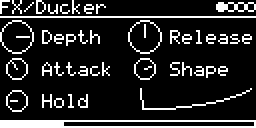

# FX/Ducker



Trigger-driven ducking: each trigger pulls the input down and lets it come back. You get sidechain-style pumping
without routing the kick's audio. Typical use is the kick's trigger ducking a pad, a bass line or a reverb tail.

```
gain
     1 ----+                          _.------
            \                     _.-'
             \               _.-'        Release (along Shape)
 1 - Depth    \_____________/
            |A|    Hold    |
            ^ trigger
```

## Parameters

| Knob | Range | Default | |
|---|---|---|---|
| **Depth** | 0 ... 1 | 0.8 (-14 dB) | gain = 1 - Depth (0.5: -6 dB, 0.9: -20 dB, 1: silent) |
| **Release** | 10 ms ... 2 s | 141 ms | time back up |
| **Attack** | 0.1 ms ... 50 ms | 1 ms | time down (linear) |
| **Shape** | fast return ... linear ... pump | 0.75 | release curve, see below |
| **Hold** | 0 ... 500 ms | 20 ms | how long it stays down before the release |

Left encoder: Depth, Attack, Hold. Right encoder: Release, Shape. The sixth slot draws the gain curve from the
trigger to the end of the release, with a line where the duck is right now.

Shape at 0 comes back fast, then slowly, like a compressor release. 0.5 is linear. Towards 1 it stays down longer
and then comes up quickly, the classic pump. The curve is never steeper than 8x a linear release, so even the 10 ms
release doesn't click.

## Usage

Load it on a free track and set its TRIG-INPUT to whatever triggers the kick (or play notes on the track's MIDI
channel). Then feed it audio on its I/O page: raise **#&lt;track&gt; &lt;engine&gt;** for the tracks to duck and set
their AUDIO-OUT to `-`, or use **AUX-INPUT** (a jack or `USB`) with **AUX-LEVEL** as the level.

Stereo, same gain on both channels. Without triggers the input passes unchanged. A trigger during the release
goes down again from where it is, without a jump, and Depth is ramped so turning it while ducked doesn't step.

CPU on the DSM about 1 %. Code 2.6 KB, RAM 180 bytes.

## License and credits

- `Ducker.cpp`: AI generated (Claude Opus 5.5), prompted and reviewed by E.Heidt; no copyright claimed, MIT license (see [License](../../../README.md#license)).
