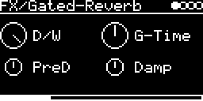

# FX/Gated-Reverb

Gated reverb: a dense burst of reflections that stops dead after the gate time. Good on drums. It's the FV-1
program "OEM1_4 Gated Reverb" from Spin Semiconductor ([OEM1_4.spn](../../../lib/fv1/spn/OEM1_4.spn)), translated to
C++ ([OEM_1_4.hpp](../../../lib/fv1/spn/OEM_1_4.hpp)) and run on the FX/FV1emu emulator. Mono in, stereo out.

## Parameters

| Knob | Range | Default | |
|---|---|---|---|
| **D/W** | 0 ... 1 | wet | dry/wet. The program outputs only the reverb |
| **G-Time** | 154 ... 292 ms, 8 steps | 236 ms | gate time |
| **PreD** | 0 ... 85 ms | ~43 ms | predelay, glides to a new setting |
| **Damp** | 0 ... 1 | 0.5 | damping inside the gate delay |

Left encoder: D/W, PreD. Right encoder: G-Time, Damp.

G-Time steps: 154, 179, 195, 213, 236, 253, 273, 292 ms.

## Usage

Use the I/O page to feed it: **AUX-INPUT** with a jack or `USB` (and **AUX-LEVEL** for the level), or
**#&lt;track&gt; &lt;engine&gt;** from other tracks. Both channels are summed.

The program comes with its own warning: "signal levels may accumulate with continuous program".

## How it works

The predelayed input goes into a long delay line. The output is the sum of 16 to 30 taps up to the G-Time
position: an FIR with no feedback, which is why the sound stops abruptly. Four lowpasses inside the delay do the
damping, and three allpasses per side make the stereo spread.

The original is written for 32.768 kHz (gate up to 436 ms, predelay up to 125 ms); here it runs at 48 kHz, so the
times are 0.68x as long.

Code 5.5 KB, RAM 66 KB.

## License and credits

- `Gated-Reverb.cpp`: © E.Heidt, MIT license (see [License](../../../README.md#license)).
- FV-1 emulator (`../../../lib/fv1`) of the Spin Semiconductor FV-1; the Spin Semiconductor programs under the Spin Semiconductor Open Reverb License (see [lib/fv1/spn/Readme.txt](../../../lib/fv1/spn/Readme.txt)).
- `../../../lib/msfa/exp2.h` (used by the FV-1 emulator) from [music-synthesizer-for-android](https://github.com/google/music-synthesizer-for-android), © Google Inc., Apache License 2.0.
