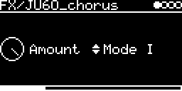

# FX/JU60_chorus

The Roland Juno-60 chorus: two bucket-brigade (BBD) delays swept by a triangle LFO, with modes I, II and I+II.
The BBDs use jpcima's [bbd-delay-experimental](https://github.com/jpcima/bbd-delay-experimental) model (Holters and
Parker, DAFx-18) with the Juno-60's input and output filters. Mode values are from the Juno-60 chorus research of
Andy Harman and JP Cimalando (links in the code).

## Parameters

| Knob | Range | Default | |
|---|---|---|---|
| **Amount** | 0 ... 1 | 1 | dry/wet. The chorus output already contains dry signal |
| **Modes** | Off, Mode I, Mode II, Mode I+II | Mode I | the Juno's chorus switch |

Left encoder: Amount. Right encoder: Modes.

| Mode | LFO | Delay L / R |
|---|---|---|
| Mode I | 0.513 Hz | 1.5 ... 5.2 ms / 1.5 ... 5.4 ms, R inverted |
| Mode II | 0.863 Hz | same as Mode I |
| Mode I+II | 9.75 Hz | 3.2 ... 3.6 ms / 3.3 ... 3.7 ms, same LFO on both |

The output is 0.44 dry + 0.56 BBD per channel.

## Usage

Route audio in on the I/O page, via **AUX-INPUT** (jack or `USB`, with **INSERT-AUX** as the level) or
**INSERT-&lt;engine&gt;** from other tracks. As in the Juno, the BBDs get the mono sum; the dry part stays stereo.

The input is soft-limited before the chorus. In Off the BBDs are switched off (they cost nothing then) but the soft
limiter still acts on the signal.

## Implementation

Each BBD has 185 stages; the LFO sweeps its clock (about 69 ... 245 kHz in modes I and II), so there are a few
clock ticks per audio sample. Input and output filters are 5-pole, computed as sums of complex one-poles with
coefficients interpolated by the tick position ([lib/bbd](../../../lib/bbd/bbd_line.cc)). As input and output are
real, only one pole of each conjugate pair is computed (3 instead of 5), and both BBDs share one input filter, as they
get the same signal.

Code 11 KB, RAM 530 bytes (plus about 8 KB on the heap). About 27k cycles a frame on the OCT41 and the DSM in modes I
and II (11 % of a frame on the DSM).

## License and credits

- `JU60_chorus.cpp`: © 2022 E.Heidt, MIT license (see [License](../../../README.md#license)).
- BBD delay line from [bbd-delay-experimental](https://github.com/jpcima/bbd-delay-experimental) by Jean Pierre Cimalando, Boost Software License 1.0.
