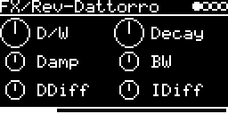

# FX/Rev-Dattorro

Plate reverb after Jon Dattorro's figure-eight design, from the Faust reverb library (`re.dattorro_rev`). The app
runs the Faust-generated C code ([rev_dattorro.dsp.h](../../../lib/faust/rev_dattorro.dsp.h) from
[rev_dattorro.dsp](../../../lib/faust/rev_dattorro.dsp)), and the DSP's six sliders are the knobs.

## Parameters

| Knob | Range | Default | |
|---|---|---|---|
| **D/W** | 0 ... 1 | 0.5 | dry/wet |
| **Decay** | 0 ... 1 | 0.5 | tank gain, i.e. decay time |
| **Damp** | 0 ... 1 | 0.5 | lowpass in the tank, higher = darker tail |
| **BW** | 0 ... 1 | 0.5 | input "bandwidth" filter, 1 = everything through |
| **DDiff** | 0.01 ... 0.99 | 0.5 | decay diffusion (tank allpasses) |
| **IDiff** | 0.01 ... 0.99 | 0.5 | input diffusion (4 input allpasses) |

Left encoder: D/W, Damp, DDiff. Right encoder: Decay, BW, IDiff. All values are smoothed (~23 ms), so turning
doesn't click.

## Usage

On the I/O page, pick **AUX-INPUT** (a jack or `USB`, level from **AUX-LEVEL**) or mix in other tracks with
**#&lt;track&gt; &lt;engine&gt;**. The reverb is fed the mono mean of L and R; output is stereo and the dry part keeps
the stereo image.

## How it works

Mono input, 0.5 ms predelay, BW filter, four input allpasses, then the classic two-half tank with damping,
decay gain and allpasses in each half. The delays are fixed (no modulation), the longest around 90 ms. Left and
right are taken where the input enters each half, so the wet signal also contains some of the diffused input
directly.

Quirk of the generated code: the BW filter feeds back y[n-2] instead of y[n-1], so it isn't a plain lowpass but a
dip centered at 12 kHz (-9.5 dB at BW 0.5).

Code 3.3 KB, RAM 129 KB.

## License and credits

- `Rev-Dattorro.cpp`: © E.Heidt, MIT license (see [License](../../../README.md#license)).
- DSP generated by [Faust](https://faust.grame.fr) (`../../../lib/faust`); the Faust libraries it uses are by GRAME and Julius O. Smith III et al., LGPL with exception.
