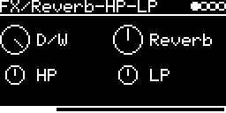

# FX/Reverb-HP-LP



Reverb followed by a resonant high-pass and low-pass, described by its author as a "dance patch for disco mixers".
It's the Spin Semiconductor FV-1 program `dance_ir_h_l` ([dance_ir_h_l.spn](../../../lib/fv1/spn/dance_ir_h_l.spn)),
translated to C++ ([dance_ir_h_l.hpp](../../../lib/fv1/spn/dance_ir_h_l.hpp)) and run on the FX/FV1emu emulator.

```
in L/R -> (L + R) / 4 -> reverb -> mix with the dry L/R (Reverb) -> HP -> LP -> out L/R
```

## Parameters

| Knob | Range | Default | |
|---|---|---|---|
| **D/W** | 0 ... 1 | wet | dry/wet. The program's output already contains dry signal |
| **Reverb** | 0 ... 1 | 0.5 | mix, decay and input in one knob, see below |
| **HP** | ~30 Hz ... 8 kHz | ~480 Hz | resonant 2-pole high-pass. Fully left = bypassed |
| **LP** | ~30 Hz ... 8 kHz | ~480 Hz | resonant 2-pole low-pass. Fully right = bypassed |

Left encoder: D/W, HP. Right encoder: Reverb, LP.

Reverb: from 0 (dry only) to 0.5 it mixes in more reverb at a fixed decay. Above 0.5 the decay gets longer and
the reverb input is faded out, so at the far right the tail holds (nearly) forever and nothing new comes in. A
freeze, basically.

With the defaults both filters sit around 480 Hz and you hear a resonant band. Turn HP fully left and LP fully
right to hear the full-range reverb.

## Usage

Set the input on the I/O page: **AUX-INPUT** for a jack or `USB` (level: **AUX-LEVEL**), or
**#&lt;track&gt; &lt;engine&gt;** to process other tracks. The reverb gets the mono sum, the dry part stays stereo.

## How it works

Four input allpasses feed a loop of two halves (two allpasses and a delay each), crossfed into each other; left
and right are tapped from different halves. The filters are two-integrator state-variable filters with a fixed
resonant damping, and the bypass at the knob ends is a blend that fades out quickly toward the middle.

The program runs at 48 kHz instead of the FV-1's usual 32.768 kHz, so delays are shorter and filter frequencies
higher than on the chip (see FX/FV1emu).

Code 5.1 KB, RAM 66 KB.

## License and credits

- `Reverb-HP-LP.cpp`: © E.Heidt, MIT license (see [License](../../../README.md#license)).
- FV-1 emulator (`../../../lib/fv1`) of the Spin Semiconductor FV-1; the Spin Semiconductor programs under the Spin Semiconductor Open Reverb License (see [lib/fv1/spn/Readme.txt](../../../lib/fv1/spn/Readme.txt)).
- `../../../lib/msfa/exp2.h` (used by the FV-1 emulator) from [music-synthesizer-for-android](https://github.com/google/music-synthesizer-for-android), © Google Inc., Apache License 2.0.
