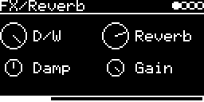

# FX/Reverb

The reverb from Mutable Instruments Clouds (`clouds::Reverb`, [lib/clouds/dsp/fx/reverb.h](../../../lib/clouds/dsp/fx/reverb.h)),
"the Griesinger topology described in the Dattorro paper": four input diffusers and a loop of two halves, with
slow modulation for a bit of shimmer. Mono sum in, stereo out.

## Parameters

| Knob | Range | Default | |
|---|---|---|---|
| **D/W** | 0 ... 1 | wet | dry/wet. The reverb output already contains dry signal |
| **Reverb** | 0 ... 1 | 0.75 | amount and length together |
| **Damp** | 0 ... 1 | 0.5 | lowpass in the loop, higher = darker |
| **Gain** | 0 ... 1 | 1 | input level into the reverb |

Left encoder: D/W, Damp. Right encoder: Reverb, Gain.

At the defaults the output is about 60 % dry and 40 % reverb, even with D/W fully wet. To get more reverb, turn
Reverb up (it also makes the tail longer).

## Usage

On the I/O page, set **AUX-INPUT** to a jack or `USB` with **INSERT-AUX** as the level, or use
**INSERT-&lt;engine&gt;** to send other tracks in. L and R are summed into the reverb; the dry part stays stereo.

## Notes

Clouds runs this at 32 kHz. Here the same sample counts run at 48 kHz, so all delays are 2/3 as long (the
longest is 100 ms) and the modulation is very slow. Delay memory is 16 bit, 32 KB.

Code 2.6 KB, RAM 33 KB.

## License and credits

- `Reverb.cpp`: © 2021 E.Heidt, MIT license (see [License](../../../README.md#license)).
- [lib/clouds](../../../lib/clouds): Mutable Instruments Clouds, © Emilie Gillet, MIT license.
