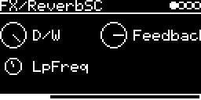

# FX/ReverbSC

Sean Costello's `reverbsc` from Csound (Sean Costello and Istvan Varga), in Soundpipe's port
([lib/soundpipe/revsc.c](../../../lib/soundpipe/revsc.c)). A feedback delay network of eight lines whose lengths
drift randomly. Stereo in, stereo out.

## Parameters

| Knob | Range | Default | |
|---|---|---|---|
| **D/W** | 0 ... 1 | wet | dry/wet |
| **Feedback** | 0 ... 1 | 0.85 | tail length. Csound's manual: 0.6 small room, 0.8 small hall, 0.9 large hall |
| **LpFreq** | 0 ... 24 kHz | 10 kHz | lowpass in every line (damping) |

Left encoder: D/W, LpFreq. Right encoder: Feedback.

## Usage

As with the other effects, the input is set on the I/O page: **AUX-INPUT** for a jack or `USB` (with
**AUX-LEVEL**), **#&lt;track&gt; &lt;engine&gt;** for other tracks.

L feeds four of the lines, R the other four. Line lengths are 44 ... 94 ms and each wanders by up to about
±1.7 ms.

With high Feedback and a steady input the tail builds up a lot of level. The output therefore goes through a
soft knee (linear up to 0.8, then tanh toward 1) so it doesn't hard clip. The knee also affects the dry signal, so
loud input changes slightly even at D/W 0. LpFreq 0 freezes the lowpass: nothing new gets into the tail.

Code 3.2 KB, RAM 108 KB.

## License and credits

- `ReverbSC.cpp`: © 2022 E.Heidt, MIT license (see [License](../../../README.md#license)).
- ReverbSC from [Soundpipe](https://github.com/PaulBatchelor/Soundpipe) by Paul Batchelor (MIT), the algorithm from Csound by Sean Costello and Istvan Varga (LGPL 2.1), see [`../../../lib/soundpipe`](../../../lib/soundpipe).
