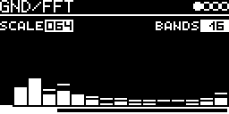

# GND/FFT

Spectrum analyser for the audio a track receives from the I/O page (AUX-INPUT and INSERT): 16, 32 or 64 bars on a
log frequency axis, each with a falling peak marker. The audio passes through to the outputs.

## Parameters

| Knob | Range | Default | |
|---|---|---|---|
| **Scale** | 000 ... 128 | 064 | gain of the pass-through, also what the analyser sees |
| **Bands** | 16, 32, 64 | 16 | number of bars |

Left encoder: Scale. Right encoder: Bands. Both are small fields at the top, shown while selected.

## Usage

Set **AUX-INPUT** (with **AUX-LEVEL** as level) or **#&lt;track&gt; &lt;engine&gt;** on the I/O page. The output is the
input times Scale.

## How it works

1024-point FFT (Takuya Ooura's `rdft`, [lib/fft/fft4g.c](../../../lib/fft/fft4g.c)) with a Hann window, a new
spectrum about every 21 ms, 46.9 Hz per bin. Bins are grouped logarithmically from 47 Hz to 24 kHz, bar height is in
decades of the summed magnitude.

## Notes

- Only the left channel is analysed.
- The FFT runs in one frame out of about 43, so the CPU load comes in spikes.
- At 32 and 64 bands the lowest bars show the same bin (with 64 bands the first seven bars all show bin 1).
- A bar sums its bins, so broadband noise looks higher toward the top end.
- The screensaver shows the bars full screen.

Code 7.4 KB, RAM 23 KB.

## License and credits

- `FFT.cpp`: © 2024 E.Heidt, MIT license (see [License](../../../README.md#license)).
- FFT by Takuya Ooura (1996-2001).
