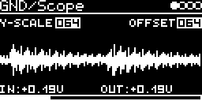

# GND/Scope

Oscilloscope for the audio a track receives from the I/O page (AUX-INPUT and INSERT). Shows the waveform and the
input and output in volts. The signal passes through with gain and offset, so it can also be used to scale and shift
a signal.

## Parameters

| Knob | Range | Default | |
|---|---|---|---|
| **Y-Scale** | 000 ... 128 | 064 | gain of the pass-through (the scope shows the output, so this scales the trace too) |
| **Offset** | 000 ... 128 | 064 (0 V) | offset added to the output, ±5 V |
| **X-Scale** | 0 ... 63 | 32 | time base, see below |

Left encoder: Y-Scale, X-Scale. Right encoder: Offset. They are small fields at the top, shown while selected.

X-Scale 0 ... 23 is triggered on a zero crossing, 2.7 ms ... 64 ms across the screen. 24 ... 63 is a rolling
min/max display, 67 ms ... 2.5 s across (0.5 s at the default). ±5 V is ±20 pixels.

## Usage

Set **AUX-INPUT** (with **INSERT-AUX** as level) or **INSERT-&lt;engine&gt;** on the I/O page. The stereo output is the
input times Y-Scale plus Offset; the trace shows the mean of both channels.

`IN` and `OUT` below the trace are single samples taken at each screen update, not averages: steady for DC, jumpy
for audio.

The screensaver shows the trace full screen.

Code 2.0 KB, RAM 272 bytes.

## License and credits

- `Scope.cpp`: © 2024 E.Heidt, MIT license (see [License](../../../README.md#license)).
