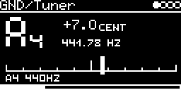

# GND/Tuner

Tuner for oscillators. Patch a VCO into an input of the module (or put an engine on an insert) and tune it. The
input passes through unchanged, so the tuner can stay in a chain.

## Display

- The note in big segments (A, b, C, d, E, F, G, `#` for sharps) and its octave (A4 = 440 Hz, C4 = middle C).
- Cents (`+7.0 CENT`) and the frequency (`441.78 HZ`, one decimal from 1 kHz up).
- A needle from -50 to +50 cents. Within 2 cents of the note a box lights up under the middle.
- `- -` when there is no pitch: silence (below -60 dBFS), noise or nothing periodic.
- A4 reference at the bottom left, 415 ... 466 Hz with the left encoder (default 440 Hz).

## Usage

On the I/O page set **AUX-INPUT** to an input jack (or `USB`) and turn up **INSERT-AUX** (at 0 the tuner sees
nothing), or use **INSERT-&lt;engine&gt;** for another track.

Range is 20 Hz ... 4 kHz. The reading updates every 100 ms, a pitch change shows after about 0.25 s. Accuracy is
within ~0.2 cents for clean waveforms, a bit worse for aliased ones.

## How it works

Pitch detection with McLeod's normalised square difference function (McLeod, Wyvill: "A smarter way to find pitch",
ICMC 2005). A coarse pass over all lags finds the period (the first strong peak, not the highest, to avoid octave
errors), then a fine pass at 48 kHz refines it, also on a multiple of the period for more precision. The work is
spread over ~95 audio frames per reading.

It measures in samples, so an oscillator played over USB audio is measured in the module's own clock.

CPU on the DSM about 6 %. Code 7.8 KB, RAM 90 KB.

## License and credits

- `Tuner.cpp`: AI generated (Claude Opus 5.5), prompted and reviewed by E.Heidt; no copyright claimed, MIT license (see [License](../../../README.md#license)).
