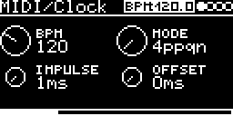

# MIDI/Clock

Clock output. Turns the module's clock (internal, T1, MIDI clock or a trigger input) into 4, 8 or 24 ppqn pulses
plus a reset pulse on two CV outputs, e.g. to clock other modules from MIDI.

## Parameters

| Knob | Range | Default | |
|---|---|---|---|
| BPM | 60 ... 250 | 120 | display only: the measured tempo of the global clock (0 if CLOCK-Source is `-`). Turning it does nothing |
| MODE | 4ppqn, 8ppqn, 24ppqn | 4ppqn | pulses per quarter note |
| Impulse | 1 ... 5 ms | 1 ms | pulse length of CLK and RST |
| Offset | 0 ... 127 ms | 0 ms | delays the CLK pulses |

Left encoder: BPM, Impulse. Right encoder: MODE, Offset.

## Inputs and outputs

- CLOCK-SOURCE on the I/O page: `CLK` for the global clock (`INT`, `T1` or `MIDI` on the settings page) or a trigger
  input. A trigger input counts as 16th notes; 8 and 24 ppqn are interpolated from the measured interval. After a
  pause of more than three intervals the next trigger is a reset.
- TRIGCLK-OUT: clock pulses, 5 V. Route it to a CV output on the I/O page.
- TRIGRST-OUT: reset pulse when the clock restarts.

## Notes

- Timing is in 0.5 ms steps.
- RST is not delayed by Offset.
- Pulses closer together than Impulse merge into one.
- BPM always shows the global clock, also when CLOCK-SOURCE is a trigger input.

Code 1.9 KB, RAM 312 bytes.

## License and credits

- `Clock.cpp`: © 2021 E.Heidt, MIT license (see [License](../../../README.md#license)).
