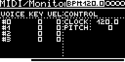

# MIDI/Monitor

Shows what arrives on the track's MIDI channel: held notes (key and velocity, four voices), pitch bend, controllers
and the clock tempo. For checking a MIDI setup; it makes no sound.

## Display

No parameters, the screen is the monitor:

| Area | Shows |
|---|---|
| VOICE KEY VEL (left) | `#0` ... `#3`: key and velocity of each held note, 0 after note off |
| CONTROL (right) | `clock:` tempo of the global clock (0.0 if CLOCK-Source is `-`) |
| | `pitch:` last pitch bend, -8192 ... +8191 |
| | `cc-N:` last value of every controller received since loading, lowest number first |

Notes are spread over four voices like a 4-voice synth would (a fifth note steals the oldest). A note on with
velocity 0 counts as note off.

## Notes

- Listens on the track's channel (MIDI-CONTROL and CHANNEL on the settings page). SysEx and realtime messages are
  ignored.
- Only five CC lines fit on the screen, more are drawn off the bottom edge.
- The firmware still applies CC 7 (level) and CC 10 (pan) to the track.

Code 2.4 KB, RAM 292 bytes.

## License and credits

- `Monitor.cpp`: © E.Heidt, MIT license (see [License](../../../README.md#license)).
