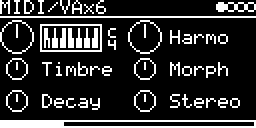

# MIDI/VAx6

Six-voice polyphonic synth played over MIDI. Each voice is the virtual analog model of Mutable Instruments Plaits
(variable square plus variable saw) with its own decay envelope, panned somewhere in the stereo field. The knobs act
on all voices.

## Parameters

| Knob | Range | Default | |
|---|---|---|---|
| V_OCT | -4 ... +4 oct | 0 | transpose, semitone steps |
| Harmo | 0 ... 1 | 0.5 | detunes the saw against the square: unison in the middle, then fifth, octave, ... two octaves (left down, right up) |
| Timbre | 0 ... 1 | 0.5 | square: silent at 0, narrow pulse to square at 0.5, above that hard sync up to 4 octaves |
| Morph | 0 ... 1 | 0.5 | saw: triangle, saw in the middle, then narrowing; fades out over the last eighth |
| Decay | 0 ... 1 | 0.5 | note decay (Plaits' LPG envelope) |
| Stereo | 0 ... 1 | 0.5 | random pan spread per note, 0 = all centre |

Left encoder: V_OCT, Timbre, Decay. Right encoder: Harmo, Morph, Stereo.

## MIDI

Listens on the track's channel (MIDI-CONTROL and CHANNEL on the settings page). Notes go to the app, not to
trigger/CV.

- Note on: starts a voice, velocity sets its level (linear).
- Note off: frees the voice; the sound decays on its own.
- Pitch bend: ±12 semitones.
- The firmware still handles CC 7 (level), CC 10 (pan) and CC 16-21 (the six knobs) as for every engine.

Stereo audio output, no trigger or V/OCT input.

## How it works

Plaits' `VirtualAnalogEngine` ([virtual_analog_engine.cc](../../../lib/plaits/dsp/engine/virtual_analog_engine.cc)),
main output only, times six, with stmlib's voice allocator (a held key retriggers its voice, otherwise the least
recently used one is taken or stolen). The envelope is Plaits' LPG envelope used as a VCA only, there is no filter.
All six voices always run, so CPU load doesn't depend on how many notes play.

Velocity only scales the level; this Plaits model doesn't use accent.

Code 13 KB, RAM 2.3 KB.

## License and credits

- `VAx6.cpp`: © 2021 E.Heidt, MIT license (see [License](../../../README.md#license)).
- [lib/plaits](../../../lib/plaits): Mutable Instruments Plaits, © Emilie Gillet, MIT license.
