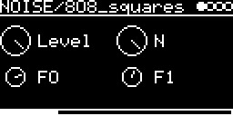

# NOISE/808_squares

Up to six square-wave oscillators at fixed, inharmonic frequencies, summed: the metallic tone source of the TR-808.
Raw material for metallic percussion. It sounds all the time, so shape it with a filter and an
envelope on another track (INSERT on the I/O page).

## Parameters

| Knob | Range | Default | |
|---|---|---|---|
| **Level** | 0 ... 1 | 1 | |
| **N** | 2 ... 6 | 6 | number of oscillators, in this order: F0, F1, 205.3, 369.6, 404.4, 522.7 Hz |
| **F0** | 254.3 Hz ... 627.2 Hz | 540 Hz | first oscillator |
| **F1** | 359.4 Hz ... 1149.9 Hz | 800 Hz | second oscillator |

Left encoder: Level, F0. Right encoder: N, F1.

## Inputs and outputs

- **V/OCT-INPUT** (with QUANTIZER and TRANSPOSE) transposes all oscillators together. 0 V or MIDI note 60 plays the
  frequencies above.
- Mono audio output.

The squares are naive (not band-limited), so they alias a bit, and all start in phase. The sum is scaled by Level / N.

Code 2.1 KB, RAM 204 bytes.

## License and credits

- `808_squares.cpp`: © 2022 E.Heidt, MIT license (see [License](../../../README.md#license)).
- helpers in `../../../lib/misc`: Biquad by Nigel Redmon (EarLevel Engineering), biquad.hpp by KORG (BSD 3-Clause), others see the headers.
