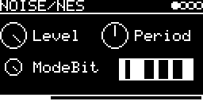

# NOISE/NES

The noise channel of the NES sound chip (APU): a 15-bit shift register clocked through the APU's table of 16 noise
periods (NTSC), with its long and short modes ([lib/misc/nes_noise.hxx](../../../lib/misc/nes_noise.hxx), after
https://www.nesdev.org/wiki/APU_Noise).

## Parameters

| Knob | Range | Default | |
|---|---|---|---|
| **Level** | 0 ... 15 | 15 | volume in 16 steps |
| **Period** | 0 ... 15 | 8 | shift rate from 179 kHz (0) down to 220 Hz (15), 4.4 kHz at 8 |
| **ModeBit** | 0, 1 | 1 | 1 = long sequence (noise), 0 = short 93-step loop that has a pitch |

Left encoder: Level, ModeBit. Right encoder: Period. The box on the right shows the 15 bits of the shift register.

Mono output. The register is sampled at 48 kHz without band limiting, so Period 0 ... 3 alias.

Code 2.1 KB, RAM 196 bytes.

## License and credits

- `NES.cpp`: © 2022 E.Heidt, MIT license (see [License](../../../README.md#license)).
- helpers in `../../../lib/misc`: Biquad by Nigel Redmon (EarLevel Engineering), biquad.hpp by KORG (BSD 3-Clause), others see the headers.
