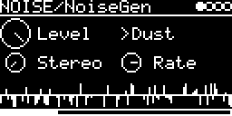

# NOISE/NoiseGen

Stereo noise generator with seven modes: white, pink and brown noise ([lib/misc/noise.hxx](../../../lib/misc/noise.hxx)),
plus Crackle and Dust adapted from [HetrickCV](https://github.com/mhetrick/hetrickcv) (CC0-1.0). For percussion,
filter sweeps or as a test signal.

Replaces `NOISE/WhitePink`, `NOISE/Crackle` and `NOISE/Dust`. Patches with WhitePink load as NoiseGen, those with
Crackle and Dust don't (the knobs moved).

## Parameters

| Knob | Range | Default | |
|---|---|---|---|
| **Level** | 0 ... 1 | 1 | |
| **Mode** | White, Pink, Brown, Crackle, Broken, Dust, Dust+ | White | |
| **Stereo** | 0 ... 1 | 0 (mono) | 1 = independent noise in each channel |
| **Chaos** | 0 ... 1 | 0.85 | Crackle and Broken only |
| **Rate** | 0 ... 1 | 0.25 (750 / s) | Dust and Dust+ only, impulse density |

Chaos and Rate share the fourth knob (right, below Mode) and it is hidden for White, Pink and Brown. Each mode group
keeps its own value; a patch stores the one of its mode. They correspond to HetrickCV's Chaos (0 ... 2) and Rate
(0 ... 4), scaled to 0 ... 1.

Below the knobs: the last 128 samples of the left output.

## Modes

- White: Park-Miller random generator per channel.
- Pink: Voss algorithm with 8 rows.
- Brown: white noise through a one-pole lowpass (about 150 Hz).
- Crackle: the chaotic map y = |d · y[n-1] - y[n-2] - 0.05|, d = 1 + Chaos³. Broken uses a one-step longer delay.
  DC is filtered out.
- Dust: random impulses, on average 48000 · Rate³ per second, bipolar. Dust+ is the unipolar version.

In mono, White/Pink/Brown use the mix of both channels (about 3 dB quieter than one), Crackle and Dust use the left
channel so the clicks keep their level.

Code 5.3 KB, RAM about 400 bytes.

## License and credits

- `NoiseGen.cpp`: © 2022 E.Heidt, MIT license (see [License](../../../README.md#license)).
- Crackle and Dust adapted from [HetrickCV](https://github.com/mhetrick/hetrickcv) by Michael Hetrick (Unfiltered Audio): CC0-1.0.
