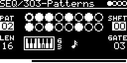

# SEQ/303-Patterns



TB-303 style bass line sequencer. Plays one of 100 stored 16-step patterns in time with the clock and outputs gate,
accent, slide and V/OCT as CV. 73 patterns are x0xb0x patterns (the source refers to a modwiggler thread for their
copyright), the other 27 "acid patterns" are marked in the source as generated by ChatGPT.

```
step     1: C        2: D slide  3: F        4: rest
GATE     ‾‾‾‾‾_____  ‾‾‾‾‾‾‾‾‾‾  ‾‾‾‾‾_____  __________      (#GATE 3: half a step)
SLIDE    __________  __________  ‾‾‾‾‾‾‾‾‾‾  __________
V/OCT    C           D           D -> F      note 0
```

## Parameters

| Knob | Range | Default | |
|---|---|---|---|
| #PAT | 0 ... 99 | 2 | pattern. Shorter patterns (4, 5, 8, 10, 12 steps) are repeated to fill 16 |
| #SHFT | -16 ... 16 | 0 | rotate: at +1 the 16th step plays first, at -1 the 2nd |
| #LEN | 0 ... 16 | 16 | number of steps played from the rotated start. 0 mutes all outputs |
| #GATE | 1 ... 6 | 3 | gate length in sixths of a step (like the 303's six clock pulses per 16th). 6 ties notes |

Left encoder: #PAT, #LEN. Right encoder: #SHFT, #GATE.

The display shows the pattern in two rows of eight: filled circle = note, open circle = note reached by a slide,
dash = rest. The running step has a ring inside. Below is a piano with the current note and `-S` / `-A` for slide
and accent.

## Inputs and outputs

- CLOCK-SOURCE: `CLK` (internal, T1 or MIDI as set in the menu) or a trigger input with one pulse per step. One
  step per 16th.
- RESET-TRIG: restarts the pattern. A MIDI note with velocity > 100 also resets, as does a clock restart (MIDI
  start, first pulse after a pause).
- V/OCT-INPUT with QUANTIZER/ROOT, TRANSPOSE and FINE transposes the pattern. MIDI notes on the track's channel
  transpose too (note 60 = no change).

| Output | Signal |
|---|---|
| GATE-OUT | 0 / 5 V gate |
| ACCENT-OUT | 0 / 5 V for the whole step of an accented note |
| SLIDE-OUT | 0 / 5 V for the whole step after a note with slide |
| VOCT-OUT | 1 V/oct, pattern C4 = 2 V, plus V/OCT input |

## How it works

Patterns come from [lib/misc/patterns_303.h](../../../lib/misc/patterns_303.h), one byte per step (note, accent bit,
slide bit). The gate length follows the clock tempo the firmware measures (120 BPM before any clock).

Slide works like on the TB-303 (see below): the slide programmed on a note keeps its gate high into the next note,
and during that next step V/OCT glides from the old note to the new one (time constant about 50 ms). Without slide
V/OCT jumps at the start of the step. Notes are quantized to the I/O page scale.

## Notes

- The glide is computed in whole pitch units and can stop short of its target by up to ~3/4 semitone when gliding
  away from the pattern's C4 (a one semitone slide up from C4 moves less than a quarter semitone). Glides towards
  C4 arrive.
- On a rest V/OCT goes to note 0 (47 semitones below C4). After a slide note followed by a rest, SLIDE is high and
  V/OCT glides down there without a gate.
- If the clock stops on a slide step, GATE stays high.

Code 6.0 KB, RAM 344 bytes.

## Background: the TB-303's slide

From https://www.firstpr.com.au/rwi/dfish/303-slide.html (excerpt):

````
Lets say you have 16 1/16 th notes programmed.  Each note occupies 
six clock pulses - lets call them pulses 0 to 5.

The gate goes high at the start of clock pulse 0 - the positive edge.

The gate goes low half-way through clock pulse 3 - on its negative 
edge.

That is for a normal, 1/16 note.  So there are 3.5 clock pulses on 
and 2.5 off.

If there is a slide programmed on that note, then the slide circuit 
is actually activated on the *next* note. The slide starts at 
the start of clock-pulse 0 and ends at the end of clock-pulse 5.

The other function of slide is that the note it is programmed on does 
not turn off, but the gate stays high and runs into the next.

Firstly, three 1/16 notes. no slide:

Clock number:  0   1   2   3   4   5   0   1   2   3   4   5   0   1   2   3   4   5   0     

Note boundary: |                       |                       |                       |   

CV:            AAAAAAAAAAAAAAAAAAAAAAAABBBBBBBBBBBBBBBBBBBBBBBBCCCCCCCCCCCCCCCCCCCCCCCCDDDD   

Gate:        __==============__________==============__________===============_________====  


Now with slide programmed on note B, which ties it to note C.

Clock number:  0   1   2   3   4   5   0   1   2   3   4   5   0   1   2   3   4   5   0     

Note boundary: |                       |                       |                       |   

CV from DAC:   AAAAAAAAAAAAAAAAAAAAAAAABBBBBBBBBBBBBBBBBBBBBBBBCCCCCCCCCCCCCCCCCCCCCCCCDDDD   

Gate:        __==============__________=======================================_________====  

Slide        __________________________________________________========================____

1 - The slide signal will go high 1/16 note after the start of 
    slid note. This includes when the slid note is 1/16 note long, 
    as in the above example.

2 - The slide signal will remain active until the end of the note
    which follows the slid note.  This includes if it is 1, 2 or 
    more 1/16 ths notes long.
````

## License and credits

- `303-Patterns.cpp`: © 2021 E.Heidt, MIT license (see [License](../../../README.md#license)).
- helpers in `../../../lib/misc`: Biquad by Nigel Redmon (EarLevel Engineering), biquad.hpp by KORG (BSD 3-Clause), others see the headers.
