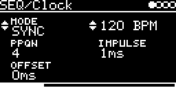

# SEQ/Clock

Clock output. Turns the module's clock (internal, T1, MIDI clock or a trigger input) into 4, 8 or 24 ppqn pulses
plus a reset pulse on two CV outputs, e.g. to clock other modules from MIDI. With MODE `FREE` it runs a clock of its
own at BPM instead, independent of the module's tempo.

## Parameters

| Knob | Range | Default | |
|---|---|---|---|
| MODE | SYNC, FREE | SYNC | `SYNC`: the clock of CLOCK-SOURCE on the I/O page. `FREE`: an own clock at BPM |
| BPM | 30 ... 255 | 120 | `SYNC`: the measured tempo of that clock (`---` without one). `FREE`: the tempo of the own clock |
| PPQN | 4, 8, 24 | 4 | pulses per quarter note |
| Impulse | 1 ... 5 ms | 1 ms | pulse length of CLK and RST |
| Offset | 0 ... 127 ms | 0 ms | delays the CLK pulses |

All parameters are text items, MODE and BPM like Time of [FX/Delay](../../FX/Delay/README.md) (`SYNC`/`FREE`,
`120 BPM`). Left encoder: MODE, PPQN, Offset. Right encoder: BPM, Impulse.

Turning BPM with `SYNC` switches to `FREE`, from the tempo shown: the clock goes on at that tempo, now its own. Back
with MODE `SYNC`. Patches of before (SEQ/Clock, MIDI/Clock) keep their values and play `SYNC`.

## Inputs and outputs

- CLOCK-SOURCE on the I/O page (MODE `SYNC`): `CLK` for the global clock (`INT`, `T1` or `MIDI` on the settings
  page) or a trigger input. A trigger input counts as 16th notes; 8 and 24 ppqn are interpolated from the measured
  interval. After a pause of more than three intervals the next trigger is a reset. With `FREE` it has no effect.
- TRIGCLK-OUT: clock pulses, 5 V. Route it to a CV output on the I/O page.
- TRIGRST-OUT: reset pulse when the clock restarts, with `FREE` when the own clock starts.

## MODE FREE

- The own clock starts when MODE becomes `FREE` (or a patch with `FREE` loads): a RST and a CLK pulse together,
  then the pulses of PPQN. It takes over the tempo BPM showed with `SYNC` (120 if it showed `---`).
- The pulses begin on their sample (20.8 µs steps), not on the 0.5 ms frame, and the tempo does not drift: 24 ticks
  a quarter note, each 60 / BPM / 24 s, counted on in samples.
- BPM can be modulated (e.g. an LFO on it); the tempo follows at once.
- Other tracks can run on it: CLOCK-SOURCE `$<track>A` (TRIGCLK-OUT of the Clock's track) with PPQN 4, since a
  trigger counts as a 16th note there. They take a pulse at the start of a frame, up to 0.5 ms after it began.

## Notes

- With `SYNC` the timing is in 0.5 ms steps (the module's clock).
- RST is not delayed by Offset.
- Pulses closer together than Impulse merge into one.
- With `SYNC`, BPM always shows the global clock, also when CLOCK-SOURCE is a trigger input.

Code 3.8 KB, RAM 448 bytes.

## License and credits

- `Clock.cpp`: © 2021 E.Heidt, MIT license (see [License](../../../README.md#license)).
