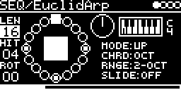

# SEQ/EuclidArp



Euclidean rhythm that plays an arpeggio. Each hit of the #LEN/#HIT/#ROT pattern plays the next note of a chord over
the root set by V_OCT. Chords and arpeggiator are taken from Mutable Instruments Plaits. Outputs trigger and V/OCT,
optionally with slides.

```
#LEN 8, #HIT 5, Mode UP, CHRD Maj7, RNGE 1-OCT
step     1   2   3   4   5   6   7   8
hit      x   .   x   x   .   x   x   .
V/OCT    0   0   4   7   7   11  0   0      semitones above the root
```

## Parameters

| Knob | Range | Default | |
|---|---|---|---|
| #LEN | 0 ... 20 | 16 | steps, 0 stops |
| V_OCT | -4 ... +4 oct | 0 | root (0 gives 0 V), plus the V/OCT input |
| #HIT | 0 ... 16 | 4 | hits |
| Mode | UP, DOWN, CYCLE, RAND | UP | arpeggiator mode. RAND is redrawn at each pattern start |
| #ROT | 0 ... 32 | 0 | rotates the hits; the arpeggio starts at the first hit from step #ROT |
| CHRD | OCT ... FD | OCT | chord, see below |
| RNGE | 1-OCT ... 4-OCT | 2-OCT | octaves the arpeggio spans |
| SLIDE | OFF, ON, RND25, RND50, RND75 | OFF | glide into all hits or a random share of them |

Left encoder: #LEN, #HIT, #ROT. Right encoder: V_OCT, Mode, CHRD, RNGE, SLIDE.

The steps are drawn as a circle like in SEQ/EuclidRythm (dot = hit, square = #ROT, frame = current step). The square
in the middle lights while the trigger is high. The screensaver adds the note of each step and a pitch line.

### Chords

Notes played, in semitones above the root:

| CHRD | Notes | CHRD | Notes | CHRD | Notes |
|---|---|---|---|---|---|
| OCT | 0 | Maj | 0 4 7 | 6th | 0 4 7 9 |
| Fifth | 0 7 | Maj7 | 0 4 7 11 | 10th | 0 4 7 10 |
| min | 0 3 7 | Maj9 | 0 2 4 11 | D7 | 0 1 7 10 |
| min7 | 0 3 7 10 | Sus4 | 0 6 7 | D7(b9) | 0 3 7 10 |
| min9 | 0 2 3 10 | 69 | 0 2 4 9 | HD | 0 3 7 9 |
| min11 | 0 3 6 10 | | | FD | 0 3 7 9 |

RNGE repeats them in the octaves above. With OCT and 1-OCT every hit plays the root.

Some chords don't match their names: from 10th on each setting plays the next chord of the bank (10th plays D7's
notes and so on, HD and FD are the same), and a rounding issue turns 5 and 6 semitone intervals into 6 and 7 (Sus4,
min11, HD, FD).

## Inputs and outputs

- CLOCK-SOURCE: `CLK` (internal, T1 or MIDI) or a trigger input with one pulse per step. One step per 16th.
- RESET-TRIG: restarts the pattern. MIDI notes with velocity > 100 and a clock restart reset too.
- V/OCT-INPUT with QUANTIZER/ROOT, TRANSPOSE and FINE transposes the arpeggio; MIDI notes on the track's channel
  too (note 60 = no change). The QUANTIZER scale also quantizes the output, glides included.

| Output | Signal |
|---|---|
| TRIG-OUT | 5 V for half a step per hit. Stays high across slides |
| VOCT-OUT | 1 V/oct: V_OCT - 2 V + V/OCT input + chord note |

## How it works

Hits come from Bjorklund's algorithm ([lib/misc/euclidean.h](../../../lib/misc/euclidean.h)). Notes come from Plaits'
chord bank ([chord_bank.cc](../../../lib/plaits/dsp/chords/chord_bank.cc), Jon Butler's chord table) and arpeggiator
([arpeggiator.h](../../../lib/plaits/dsp/engine2/arpeggiator.h)). The arpeggio is laid out in advance and restarts
with every round of the pattern; steps without a hit keep the previous note. A slide glides to the new note in half
a step along Peaks' exponential envelope curve.

## Notes

- Easter egg: #LEN 16, #HIT 16, Mode RAND, CHRD OCT, RNGE 1-OCT plays "Daft Punk - Da Funk" from
  [lib/misc/patterns_303.h](../../../lib/misc/patterns_303.h), with slides, rotated by #ROT.
- #ROT >= #LEN gives the same hits as #ROT modulo #LEN, but the arpeggio starts on another note.

Code 11 KB, RAM 1.3 KB.

## License and credits

- `EuclidArp.cpp`: © 2021 E.Heidt, MIT license (see [License](../../../README.md#license)).
- helpers in `../../../lib/misc`: Biquad by Nigel Redmon (EarLevel Engineering), biquad.hpp by KORG (BSD 3-Clause), others see the headers.
- [lib/peaks](../../../lib/peaks): Mutable Instruments Peaks, © Emilie Gillet, MIT license.
- [lib/plaits](../../../lib/plaits): Mutable Instruments Plaits, © Emilie Gillet, MIT license.
