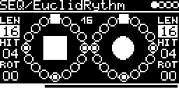

# SEQ/EuclidRythm



Two Euclidean rhythms in time with the clock, each spreading its hits as evenly as possible over its steps. Four
trigger outputs: A, B, A OR B, A AND B. Different lengths give polyrhythms.

```
#LEN 8,  #HIT 3            x..x..x.
#LEN 8,  #HIT 5            x.xx.xx.
#LEN 16, #HIT 4            x...x...x...x...
#LEN 8,  #HIT 3, #ROT 1    .x..x..x
```

## Parameters

| Knob | Range | Default | |
|---|---|---|---|
| #LEN (A, B) | 0 ... 20 | 16 | steps. 0 silences the rhythm |
| #HIT (A, B) | 0 ... 16 | 4 | hits |
| #ROT (A, B) | 0 ... 32 | 0 | rotation in steps, modulo #LEN |

Left encoder: A's #LEN, #HIT, #ROT. Right encoder: the same for B.

Each rhythm is drawn as a circle, first step at the top, clockwise: dot = hit, square = rotated start, small frame =
current step. The shape in the middle lights on a hit. The top centre shows the clock's step counter.

## Inputs and outputs

- CLOCK-SOURCE: `CLK` (internal, T1 or MIDI) or a trigger input with one pulse per step. One step per 16th.
- RESET-TRIG: both rhythms restart. MIDI notes with velocity > 100 and a clock restart reset too.
- Outputs (I/O page), all 5 V / 10 ms triggers:

| Output | Trigger on |
|---|---|
| TRIG1-OUT | hits of A |
| TRIG2-OUT | hits of B |
| TRIGS-OR-OUT | A or B |
| TRIGS-AND-OUT | A and B on the same step |

## How it works

Bjorklund's algorithm from [lib/misc/euclidean.h](../../../lib/misc/euclidean.h) (the header links Toussaint's paper
on Euclidean rhythms). Integer math only, so it would also run on a Teensy 3.2.

## Notes

- The step position is 8 bit, so both rhythms restart every 256 steps. With a length that doesn't divide 256 one
  step plays out of turn there (#LEN 3, #HIT 1 hits on step 255 and again on 256).

Code 4.7 KB, RAM 480 bytes.

## License and credits

- `EuclidRythm.cpp`: © 2021 E.Heidt, MIT license (see [License](../../../README.md#license)).
- helpers in `../../../lib/misc`: Biquad by Nigel Redmon (EarLevel Engineering), biquad.hpp by KORG (BSD 3-Clause), others see the headers.
