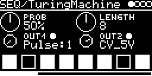

# SEQ/TuringMachine



Turing Machine style looping random sequencer. A 16-bit shift register is clocked by the module's clock and the bit
coming round is flipped by chance. At 0 % the loop repeats, at 50 % it's random, in between the loop changes slowly.
Two outputs turn the newest 8 bits into pulses, a stepped voltage or notes.

```
   +---- flipped with chance Prob ----+
   v                                  |   the bit read: b(16 - Length), here Length 8
   b15  b14  b13  b12  b11  b10  b9   b8   b7 ... b0     one place to the right each step
   |______________ byte _______________|
                Out1, Out2
```

## Parameters

| Knob | Range | Default | |
|---|---|---|---|
| Prob | 0 ... 100 % | 50 % | chance per step to flip the bit. 0 % locks the loop, 100 % inverts it every round (twice the length) |
| Length | 0 ... 16 | 8 | loop length in steps. 0 stops the register |
| Out1 | see below | Pulse:1 | |
| Out2 | see below | CV_5V | |

Left encoder: Prob, Out1. Right encoder: Length, Out2. Prob moves in 5 % steps when turned fast.

The eight squares at the bottom show the byte, newest bit on the left. The dots next to Out1/Out2 light while the
output is above 0 V.

### Output modes

| Mode | Output |
|---|---|
| Pulse:1 ... Pulse:7 | 5 V for half a step when its bit is set. Pulse:1 is the newest bit, Pulse:n is n - 1 steps old |
| P:1+2, P:2+4, P:4+7, P:+1247 | pulse when any of these bits is set |
| P:1&2, P:2&4, P:4&7, P:&1247 | pulse when all of them are set |
| CV_5V | the byte as 0 ... 5 V in 255 steps |
| NOTE-7 | low 7 bits as a note, -64 ... +63 around 0 V |
| NOTE-6 ... NOTE-3 | low 6 ... 3 bits as a note from 0 V up (0 ... 63, 31, 15 or 7 notes) |

A note is a semitone, or a scale step if a QUANTIZER is set on the I/O page. The NOTE modes follow Enigma from O_C
Hemisphere Suite.

## Inputs and outputs

- CLOCK-SOURCE: `CLK` (internal, T1 or MIDI) or a trigger input with one pulse per step. One step per 16th.
- RESET-TRIG: jumps back to the stored reset point (see below). MIDI notes with velocity > 100 and a clock restart
  reset too.
- V/OCT-INPUT with QUANTIZER/ROOT, TRANSPOSE and FINE transposes CV_5V and the NOTE modes; MIDI notes on the
  track's channel too (note 60 = no change). Pulse outputs stay 0 / 5 V.
- Outputs Out1-OUT and Out2-OUT, routed on the I/O page.

## Reset point

Whenever Prob or Length changes, the register and the random generator state are stored and saved with the patch.
A reset loads them again, so the same random sequence replays from there. Modulating Prob or Length therefore stores
a new reset point at every change.

## Notes

- With Length 0 the outputs keep their last values.
- No mode uses bit 0 of the byte.
- Integer math only.

Code 4.5 KB, RAM 428 bytes.

## License and credits

- `TuringMachine.cpp`: © 2024 E.Heidt, MIT license (see [License](../../../README.md#license)).
