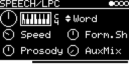

# SPEECH/LPC

The LPC speech synth of Mutable Instruments Plaits with its 92 words (colours, numbers, letters, NATO alphabet and
synth words), LPC10-encoded from Texas Instruments ROMs. A trigger speaks the selected word at the V/OCT pitch.

## Parameters

| Knob | Range | Default | |
|---|---|---|---|
| V_OCT | -4 ... +4 oct | 0 | pitch, plus V/OCT input |
| Word | 0 ... 91 | 0 (red) | word, see below |
| Speed | 0 ... 1 | 0.3 | 0 = recorded rate, 1 = four times faster |
| Form.Shift | 0 ... 1 | 0.5 | formant shift ±18 semitones. Outside 0.4 ... 0.6 it also changes the speed |
| Prosody | 0 ... 1 | 0.5 | 0 = monotone, 1 = full recorded intonation |
| AuxMix | 0 ... 1 | 0 | left output from speech to the raw excitation (buzz/noise before the vocal filter) |

Left encoder: V_OCT, Speed, Prosody. Right encoder: Word, Form.Shift, AuxMix.

### Words

| Word | |
|---|---|
| 0 ... 6 | red, orange, yellow, green, blue, indigo, violet |
| 7 ... 17 | zero, one, two, three, four, five, six, seven, eight, nine, ten |
| 18 ... 43 | the letters a ... z |
| 44 ... 69 | alpha, bravo, charlie, ... zulu |
| 70 ... 91 | analog, circuit, clock, control, digital, electronic, filter, frequency, generator, instrument, knob, machine, modular, modulator, operator, oscillator, patch, sequencer, synthesizer, vca, voltage, waveform |

## Inputs and outputs

- TRIG-INPUT: speaks the word from the start; a new trigger restarts it.
- V/OCT-INPUT with QUANTIZER and TRANSPOSE. Knob at 0 and 0 V is about 65 Hz (MIDI note 36).
- MIDI notes on the track's channel trigger it and add their pitch.
- Stereo output: left the speech (or mix with AuxMix), right the excitation alone.

## How it works

Plaits' LPC speech synth ([lpc_speech_synth_controller.cc](../../../lib/plaits/dsp/speech/lpc_speech_synth_controller.cc),
[lpc_speech_synth.cc](../../../lib/plaits/dsp/speech/lpc_speech_synth.cc), words in
[lpc_speech_synth_words.cc](../../../lib/plaits/dsp/speech/lpc_speech_synth_words.cc)): a glottal pulse or noise
into a 10th-order lattice filter at 8 kHz (shifted by Form.Shift), band-limited up to 48 kHz. The output goes through
a limiter as in Plaits.

## Notes

- Before the first trigger, and after Word moves into another bank (colours, numbers, letters, NATO, synth words),
  you hear a looping frame from the middle of the bank instead of a word until the next trigger. This is Plaits' scan
  mode.

Code 21 KB, RAM 18 KB.

## License and credits

- `LPC.cpp`: © E.Heidt, MIT license (see [License](../../../README.md#license)).
- [lib/plaits](../../../lib/plaits): Mutable Instruments Plaits, © Emilie Gillet, MIT license.
